<div align="center">

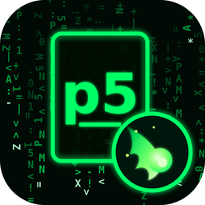

# p5assets

**Deutsch** · [English](README.md)

**Fehlende Poster und Staffelcover für Plex, Sonarr, Radarr und Kometa – finden, ersetzen, fertig.**

Ein schlanker Docker-Container im Matrix-Look. Er vergleicht deine Bibliotheken mit dem
[Kometa](https://kometa.wiki)-Assets-Ordner, zeigt dir, was fehlt, und legt neue Bilder automatisch unter Kometa-konformen Namen ab.


-ffcc00?labelColor=0a1a0f)

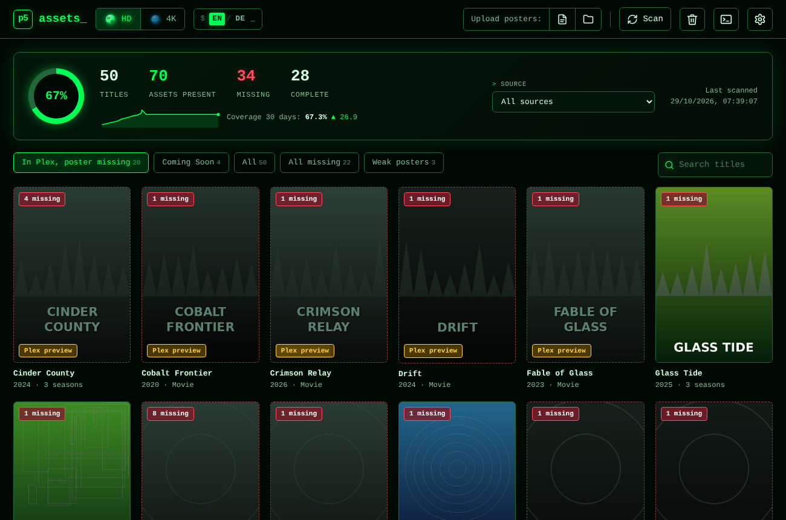

<sub>Alle Titel in den Bildern sind erfunden.</sub>

</div>

## Funktionen

Die Oberfläche gibt es auf Englisch und Deutsch (Sprachumschalter in der Kopfzeile, Standard ist Englisch).

### Lücken finden
p5assets führt Plex, Sonarr und Radarr zusammen (über TMDb-, TVDB- und IMDb-IDs). Die Reiter zeigen sofort, was zu tun ist:
**In Plex, Poster fehlt** (die Startansicht: alles, was in Plex ohne Bild erscheint), **Coming Soon**, **Alle**, **Alle fehlenden** (auch Titel, die nur Sonarr oder Radarr kennen und die noch nicht in Plex sind; sie tragen das Etikett „Noch nicht in Plex“) und **Schwache Poster**.
Dazu kommen eine Quellenauswahl, eine Schnellsuche (rechts neben den Reitern; sie durchsucht immer alle Titel der Welt), eine A–Z-Leiste und eine Abdeckungsanzeige mit kleinem Verlauf pro Scan.
Große Bibliotheken sind kein Problem: Bei über 6000 Titeln antworten die Listen in rund 30 ms.

### Ersetzen per Drag & Drop
Zieh ein Bild auf eine Kachel oder mehrere Dateien, ganze Ordner oder ZIPs irgendwo ins Fenster – oder wähl sie über „Poster hochladen:“ in der Kopfzeile aus (Datei-/ZIP-Symbol oder Ordner-Symbol; auf iPhone und iPad gibt es eine einzige Schaltfläche, Ordner lädst du dort als ZIP hoch). p5assets erkennt Titel,
Jahr und Staffel an den Datei- und Ordnernamen, zeigt dir die Zuordnung zur Kontrolle und benennt alles Kometa-konform
(`<Medienordner>/poster.jpg`, `Season01.jpg` …). Neue Ordner landen dort, wo deine anderen Titel schon liegen.

**Set-Kontrolle beim Import:** Enthält ein Upload ein Serien-Set (auch mehrere Serien in einer ZIP, nach Serie gruppiert), prüft p5assets
für jede Serie, wie viele Staffeln Plex (und Sonarr) kennen, ob das Set alle abdeckt, ob Serienposter und Specials dabei sind
und welche vorhandenen Bilder ersetzt würden.

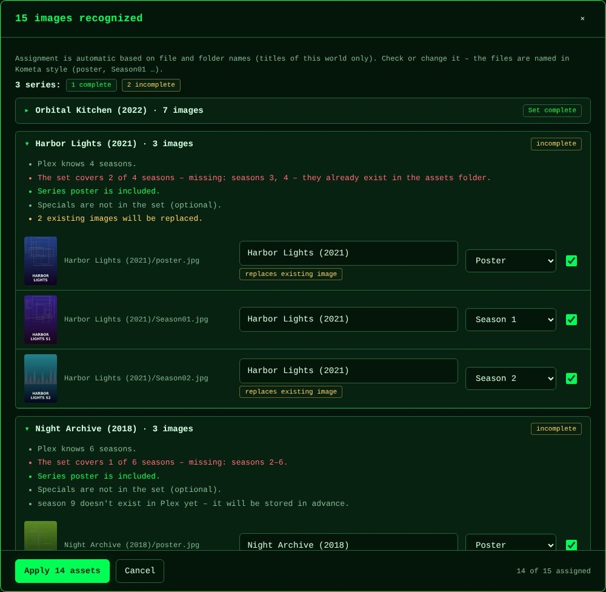

<table>
<tr>
<td width="50%">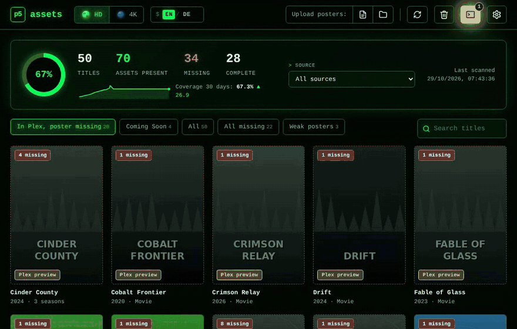<br><sub>Staffelposter ergänzen – Matrix-Regen nur dort, wo sich etwas ändert</sub></td>
<td width="50%">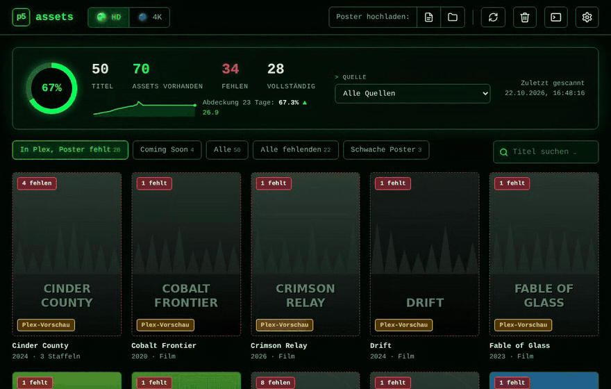<br><sub>ZIP hochladen: automatische Zuordnung, Abdeckung steigt</sub></td>
</tr>
</table>

### Filme und Serien
<table>
<tr>
<td width="50%">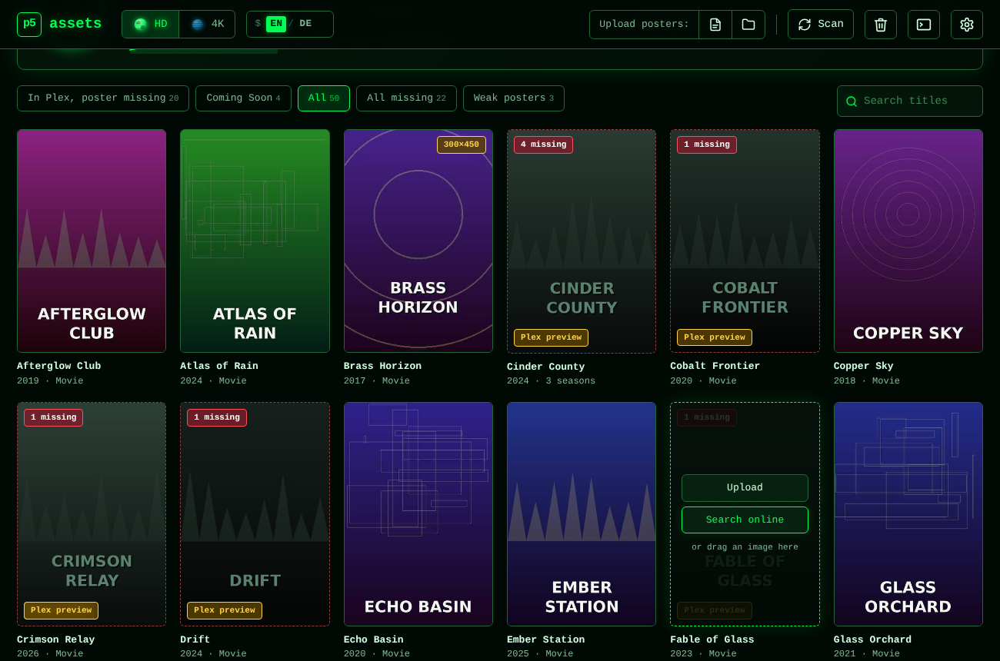<br><sub>Filme direkt am Poster bearbeiten (am Touchscreen per Tippen)</sub></td>
<td width="50%">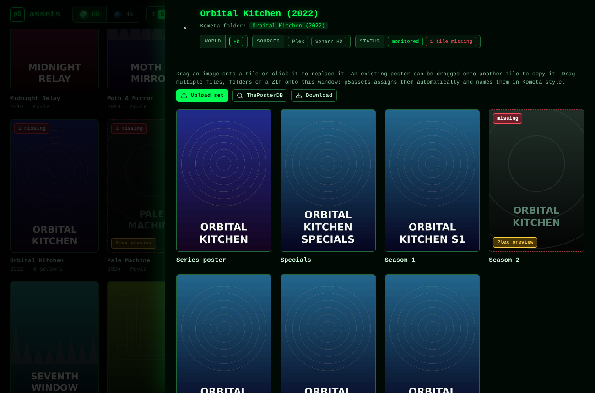<br><sub>Serien: Poster und Staffeln, <b>Set hochladen</b>, ThePosterDB-Link, ZIP-Download</sub></td>
</tr>
</table>

- Kacheln für das Poster und **Season00 – Season50**, auch für Staffeln, die es noch nicht gibt
- Poster per Drag & Drop auf eine andere Kachel **kopieren** oder mit **„Auf alle …“** auf mehrere Kacheln übertragen
- **Plex-Collections:** Filme zeigen in der Vorschau ihre Collection; ein Klick öffnet deren Detailansicht mit allen Postern (ersetzen, hochladen, Set-Upload). Beim Import gruppiert p5assets die Filme nach Plex-Collection und sagt dir, welche Filme der Collection danach noch kein Poster haben. Dateien wie „… Collection“ ordnet der Import nicht automatisch einem Film zu. Große Sammel-Collections, die keine Filmreihen sind, kannst du ausblenden (unter Einstellungen → Bibliotheken siehst du sie und holst sie zurück)

<table>
<tr>
<td width="50%">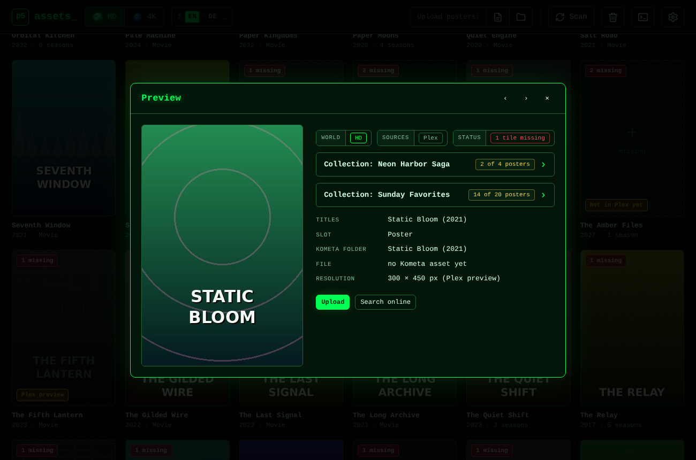<br><sub>Die Vorschau nennt die Plex-Collections des Films</sub></td>
<td width="50%">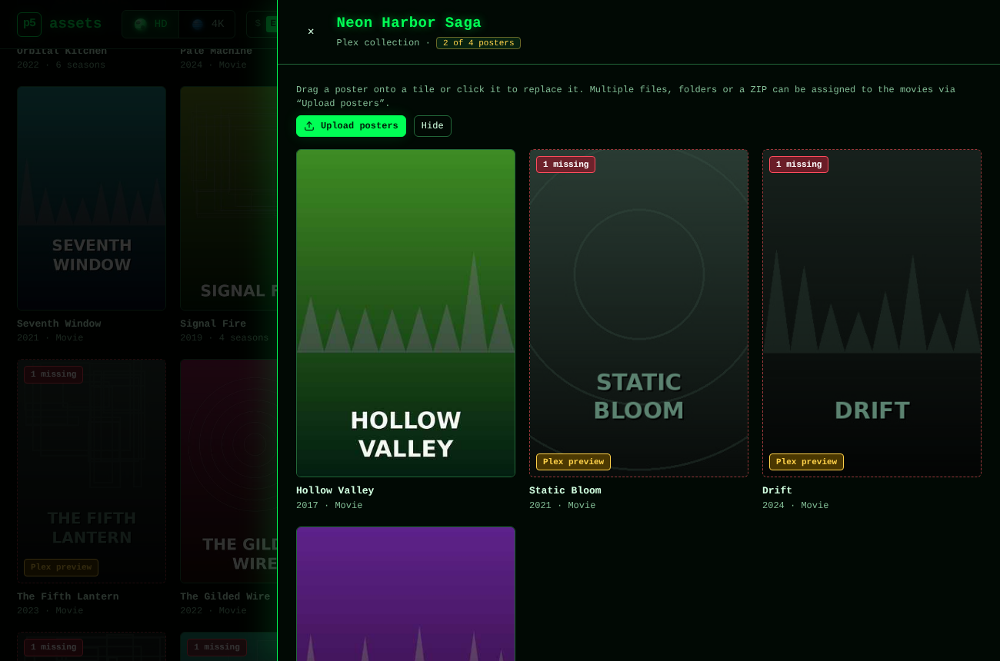<br><sub>Detailansicht: alle Poster der Collection, fehlende sofort ersetzbar</sub></td>
</tr>
</table>

- **Herunterladen** in Originalqualität: einzelne Poster oder eine Auswahl als ZIP (auf iPhone und iPad öffnet sich das Original in p5assets: Bild lange drücken → „Zu Fotos hinzufügen“)

### Online-Suche
Poster von TMDb, TVDB und fanart.tv, gruppiert nach deiner **Sprach-Priorität pro Welt** (z. B. Textless → Deutsch → Englisch),
übernimmst du mit einem Klick. Für ThePosterDB öffnet ein Link die Suche mit dem passenden Namen; das Poster oder Set,
das du dort herunterlädst, legst du einfach in p5assets ab (kein Login, kein Auslesen der Seite).

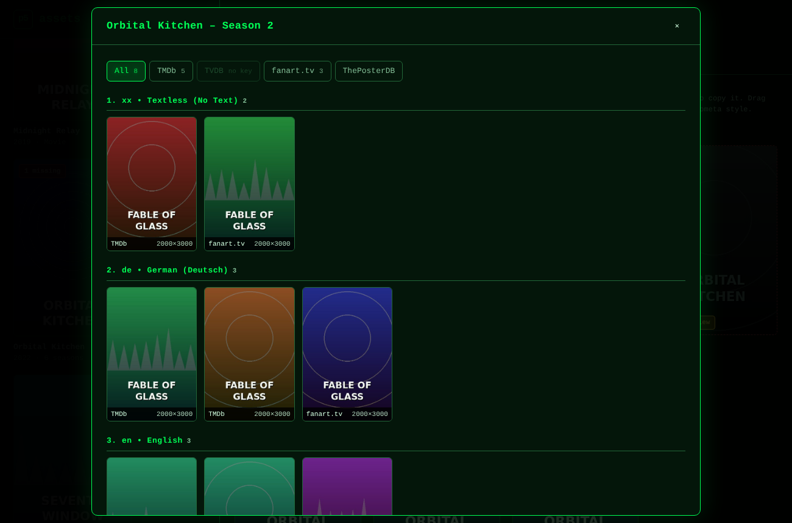

### Welten (HD, 4K, …)
Getrennte Bereiche mit eigenem Assets-Ordner, eigener Titelliste, eigenem Dashboard und **eigener Farbe**: Zehn Welten
stehen zur Auswahl, jede mit eigenem Planeten in der Kopfzeile; der Wechsel ist eine kurze Reise durchs Wurmloch. Bibliotheken und
Sonarr-/Radarr-Instanzen ordnest du den Welten per Drag & Drop zu.

<table>
<tr>
<td width="50%">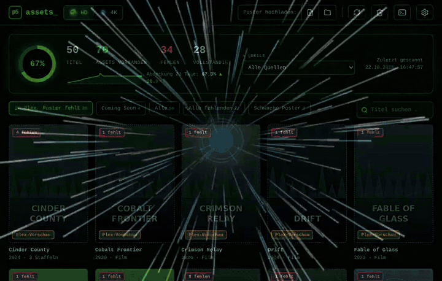<br><sub>Weltenwechsel HD ↔ 4K</sub></td>
<td width="50%">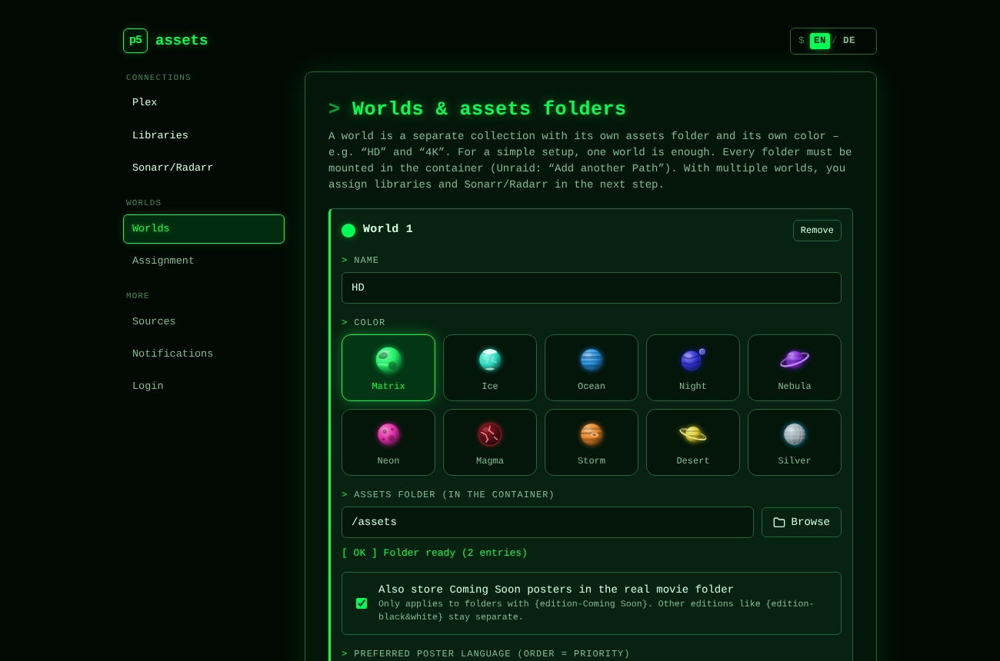<br><sub>Zehn Welten mit eigenem Planeten</sub></td>
</tr>
</table>

### Coming Soon
Plex-Platzhalter mit `{edition-Coming Soon}` im Ordnernamen haben einen eigenen Reiter (auf Wunsch nur die ohne Poster).
Ihre Poster landen zusätzlich im echten Radarr- bzw. Sonarr-Ordner (pro Welt abschaltbar), damit sie den Wechsel
zur echten Datei überstehen. Andere Editionen bleiben getrennt.

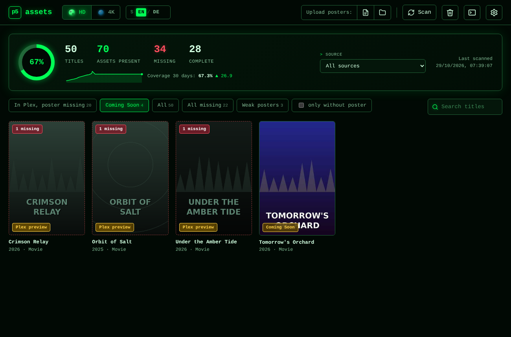

### Qualität prüfen: Schwache Poster
Der Reiter findet Bilder, die zu klein sind oder nicht das Seitenverhältnis 2:3 haben. Die Schwellwerte (Mindestbreite, Seitenverhältnis) wählst du selbst;
die Bildgrößen liest p5assets im Hintergrund.

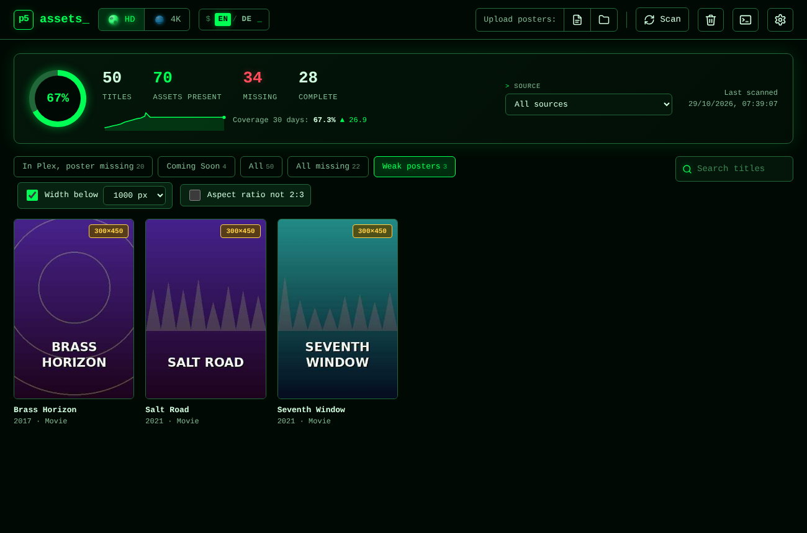

### Papierkorb & Aufräumen
Ersetzte oder gelöschte Poster bleiben **30 Tage im Papierkorb** (höchstens 2 GB). Nach jeder Aktion bietet ein Hinweis
„Rückgängig“ an; das Papierkorb-Symbol in der Kopfzeile öffnet die ganze Liste. **Verwaiste Ordner** (Poster ohne Titel in Plex,
Sonarr oder Radarr) kannst du aufspüren und in den Papierkorb verschieben; Titel, die Sonarr oder Radarr
noch kennen, bleiben geschützt.

<table>
<tr>
<td width="50%">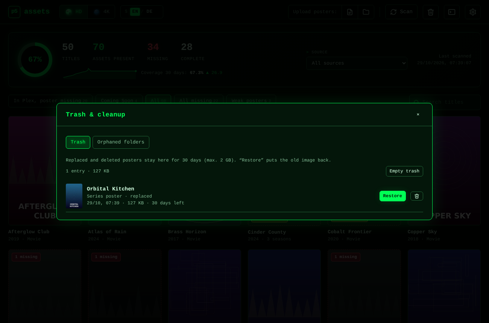<br><sub>Papierkorb mit Wiederherstellen</sub></td>
<td width="50%">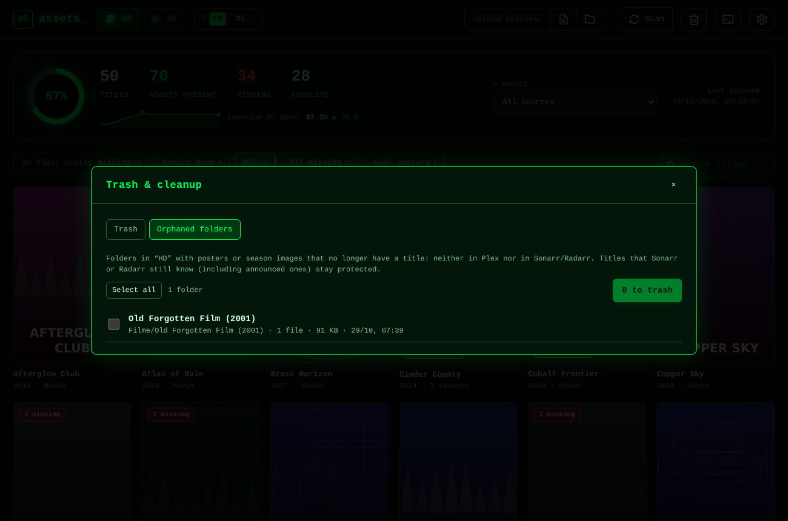<br><sub>Verwaiste Ordner aufräumen</sub></td>
</tr>
</table>

### Benachrichtigungen
Nach einem Scan meldet sich p5assets per **Discord, Telegram oder ntfy**, und zwar nur in zwei Fällen:
neue Titel unter „In Plex, Poster fehlt“ (eine Nachricht, Coming-Soon-Titel sind markiert, zum Beispiel „4 new titles without poster, 2 of them Coming Soon“) und
Fehler beim Scan (einmal pro Fehler). Die Nachrichten selbst sind immer englisch. Der erste Scan legt nur den
Ausgangsstand fest. Du richtest die Benachrichtigungen bei der Einrichtung ein (Schritt überspringbar) oder später in den Einstellungen; eine Testnachricht zeigt, ob alles ankommt.

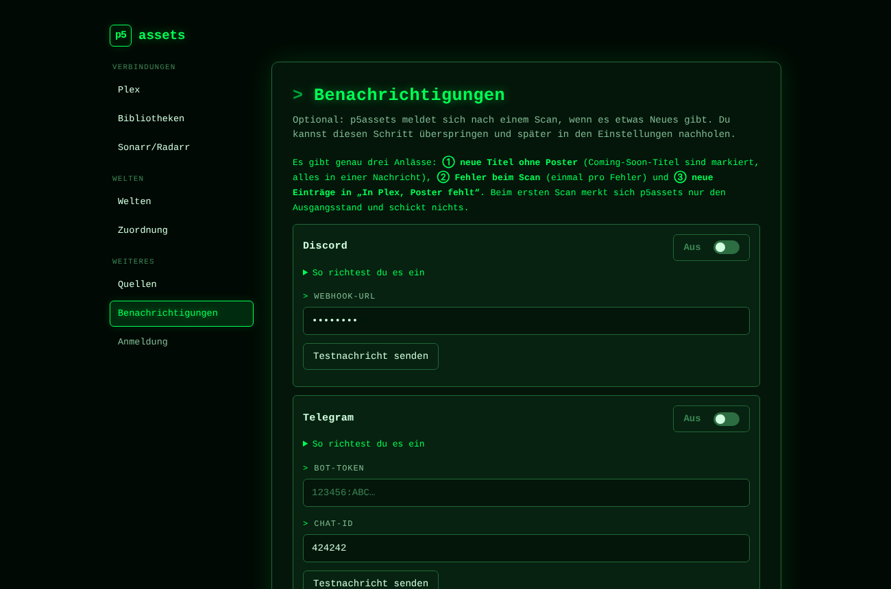

### Logs, Neuigkeiten, Mobil
- **Log-Seite** (Symbol `>_`): Live-Log mit Suche, Level-Filter und Download. Bei neuen Warnungen oder Fehlern leuchtet das Symbol auf und zeigt die Anzahl. Tokens und API-Keys landen nie im Log.
- **Neu in diesem Update**: Nach einem Update zeigt dir p5assets, was neu ist, und bietet an, neue Funktionen gleich einzurichten (später jederzeit über „Neuigkeiten“ in der Fußzeile).
- **Als App** auf iPhone und iPad (Teilen → Zum Home-Bildschirm), mit kompakter Kopfleiste und großen Tippflächen; die Einstellungen sind dort eine gruppierte Liste (am Desktop eine Seitenleiste).
- **Tastaturkürzel:** `/` springt ins Suchfeld, `Esc` leert es, in der Poster-Vorschau blätterst du mit `←`/`→` durch die Filme. Ein Klick aufs Logo führt immer zur Startseite.

<table>
<tr>
<td width="50%">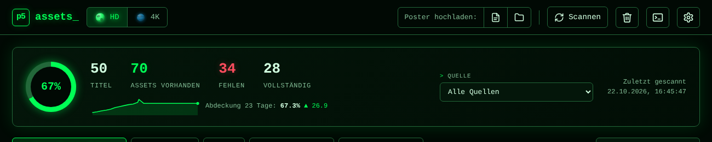<br><sub>Log-Symbol mit Alarm und Hinweis im Dashboard</sub></td>
<td width="50%">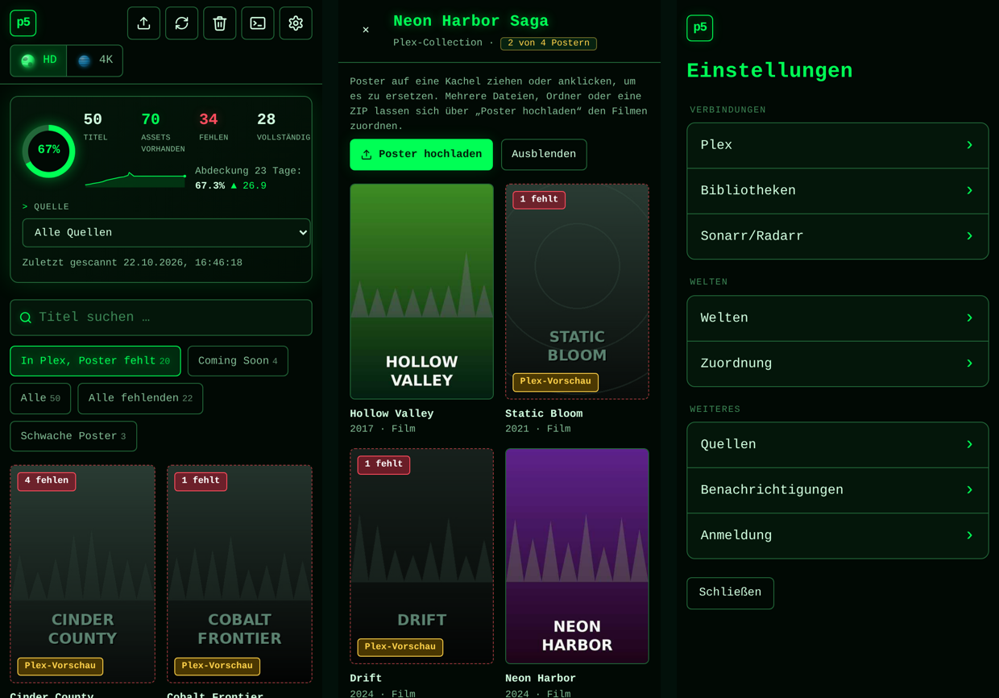<br><sub>Mobil / iPhone</sub></td>
</tr>
</table>

## Schnellstart (Docker Compose)
```yaml
services:
  p5assets:
    image: ghcr.io/p5lukas/p5assets:dev
    ports: ["8484:8080"]
    environment: { PUID: 99, PGID: 100, UMASK: "002", TZ: Europe/Berlin }
    volumes:
      - ./config:/config
      - /pfad/zu/kometa/assets:/assets          # Welt 1 (z. B. HD) – muss dein Kometa asset_directory sein
      - /pfad/zu/kometa/assets-4k:/assets-4k    # optional: Welt 2 (4K)
    restart: unless-stopped
```
Öffne dann http://localhost:8484 und geh die Einrichtung durch (Plex, Welten, Sonarr/Radarr, API-Keys).
Die Assets-Ordner müssen **beschreibbar** eingebunden sein. Die Ordnernamen leitet p5assets aus dem Medienpfad in Plex bzw.
Sonarr/Radarr ab – genau so sucht Kometa nach Assets.

Aus dem Quellcode: `docker compose up -d --build`.

## Unraid
1. Bring das Template **und das Icon** auf den Server. Am einfachsten geht das über die Netzwerkfreigabe (klappt auch bei einem privaten Repo):
   `unraid/p5assets.xml` → `\\<Unraid-IP>\flash\config\plugins\dockerMan\templates-user\my-p5assets.xml`
   (Alternativ bei einem öffentlichen Repo per Terminal:
   `wget -O /boot/config/plugins/dockerMan/templates-user/my-p5assets.xml https://raw.githubusercontent.com/p5lukas/p5assets/dev/unraid/p5assets.xml`)
2. *Docker → Add Container* → unter *User templates* das Template **p5assets** wählen.
3. Pfade setzen: **Config** (z. B. `/mnt/user/appdata/p5assets`), **Assets 1** (dein Kometa-`asset_directory`),
   bei Bedarf **Assets 2** (z. B. 4K). Nicht benötigte Assets-Pfade lässt du leer.
4. Der Host-Port ist standardmäßig **8484**. Ist er belegt, änderst du nur den Host-Port, nicht den Container-Port 8080.
5. WebUI öffnen und die Einrichtung durchgehen. Als Plex-URL trägst du `http://<Unraid-IP>:32400` ein.

### Image-Tags
| Tag | Quelle | Zweck |
|---|---|---|
| `:dev` | Branch `dev` | Neues testen |
| `:latest` | Branch `main` | stabil |
| `:0.6.0` | Git-Tag `v0.6.0` | feste Version (aktuell `0.6.0`, `1.0.0` erst bei ausgereiftem Stand) |
| `:sha-…` | jeder Build | Fehlersuche |

Solange p5assets in Entwicklung ist, nutzen Template und Compose-Datei `:dev`. Sobald alles stabil läuft,
stellen beide auf `:latest` (Branch `main`) um: Ändere dann im Container-Formular das Feld *Repository* auf
`ghcr.io/p5lukas/p5assets:latest`.

> Ist das GHCR-Paket privat, braucht Unraid einen Login: `docker login ghcr.io -u p5lukas` mit einem Token, das **nur** `read:packages` darf.

Gebaut wird per GitHub Action (`.github/workflows/docker.yml`) bei jedem Push auf `dev` bzw. `main`.
Dateien werden mit `PUID=99` / `PGID=100` (nobody/users) geschrieben.
Updates: Container in Unraid per *Force Update* aktualisieren.

## Speicherbedarf in `/config`
| Ordner | Inhalt | Größe |
|---|---|---|
| `config.json` | Einstellungen, Zugangsdaten (Token/API-Keys, nie im Log) | klein |
| `cache/thumbs-v3` | Vorschaubilder für schnelle Listen | höchstens 600 MB, wird automatisch bereinigt |
| `trash` | Papierkorb mit Rückgängig-Funktion | höchstens 2 GB, 30 Tage |
| `cache/dims.json`, `history.json`, `logs` | Bildgrößen, Abdeckungsverlauf, Log | klein |

## Anmeldung & Passwort zurücksetzen
Auf Wunsch schützt du p5assets mit **Benutzername und Passwort** (Einrichtungsschritt „Anmeldung“ oder später in den Einstellungen).
Das Passwort wird nur als Hash (scrypt) in `/config/auth.json` gespeichert. Die Anmeldung gilt auf Wunsch 30 Tage, und nach mehreren
Fehlversuchen gibt es eine Wartezeit. Die Anmeldeseite übernimmt die Farbe der zuletzt benutzten Welt.

<table>
<tr>
<td width="50%">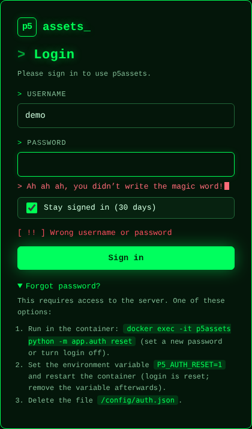<br><sub>Anmeldeseite (nach einem falschen Passwort: kleine Terminal-Überraschung, abschaltbar)</sub></td>
<td width="50%">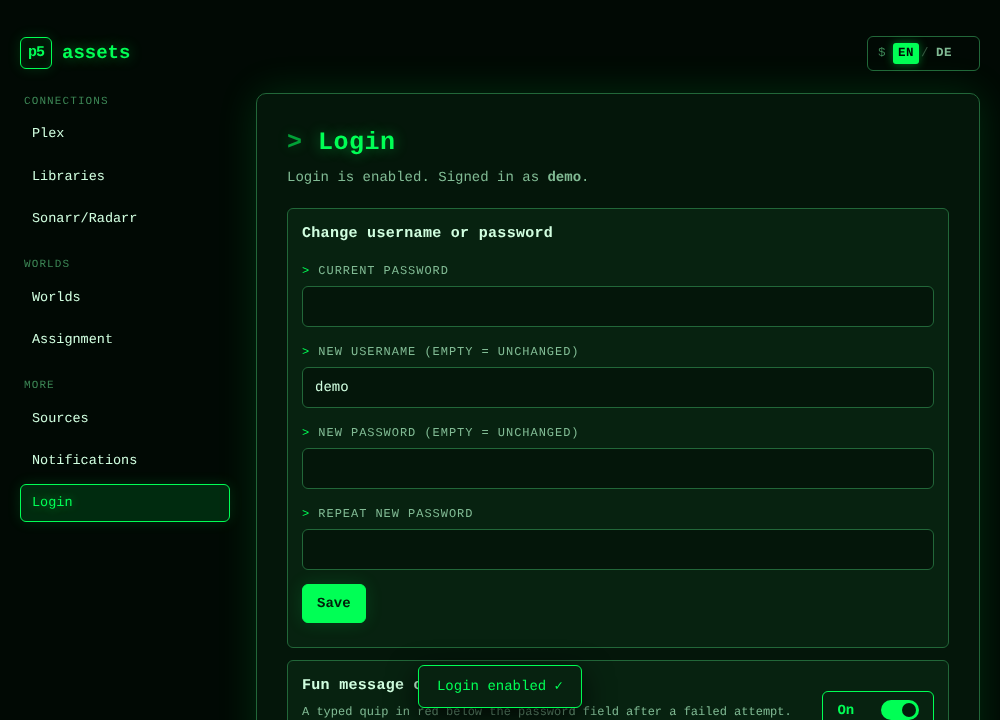<br><sub>Einstellungen → Anmeldung</sub></td>
</tr>
</table>

**Passwort vergessen?** Mit Zugriff auf den Server gibt es drei Wege:
1. `docker exec -it p5assets python -m app.auth reset` – neues Passwort setzen oder die Anmeldung ausschalten (`python -m app.auth status` zeigt den aktuellen Zustand).
2. Die Umgebungsvariable `P5_AUTH_RESET=1` setzen und den Container neu starten: Die Anmeldung wird zurückgesetzt (danach die Variable wieder entfernen und die Anmeldung neu einrichten).
3. Die Datei `/config/auth.json` löschen.

## Hinweise
Ohne eingeschaltete Anmeldung kann jeder im Netzwerk p5assets bedienen – betreib es dann nur im Heimnetz oder hinter einem Reverse Proxy mit Login.
Greifst du über das Internet zu, nutz zusätzlich `https://` (Reverse Proxy), damit Passwort und Sitzung verschlüsselt übertragen werden.
Tipp: p5assets gehört nicht direkt ins offene Internet (keine Portfreigabe am Router). Besser erreichst du es per VPN (z. B. WireGuard/Tailscale) oder hinter einem Reverse Proxy mit `https://`.
Plex-Token, API-Keys und Zugangsdaten für Benachrichtigungen liegen in `/config/config.json` und werden nie ins Log geschrieben.
Verbindungen zu Plex, Sonarr und Radarr im Heimnetz akzeptieren selbstsignierte Zertifikate (üblich bei `https://` im LAN); die Online-Suche und Benachrichtigungen ins Internet nutzen die normale Zertifikatsprüfung.

Die Tests (`pytest`) laufen in der GitHub Action vor jedem Image-Build.

## Lizenz
p5assets steht unter der [GNU General Public License v3.0](LICENSE) (GPL-3.0): Du darfst den Code nutzen, ändern und weitergeben.
Abgeleitete Werke, die du verbreitest, müssen ebenfalls unter der GPL-3.0 stehen und ihren Quellcode offenlegen.
Das Projekt ist unabhängig von Plex, Sonarr, Radarr, Kometa, TMDb, TVDB, fanart.tv und ThePosterDB und nicht mit ihnen verbunden.
