<div align="center">

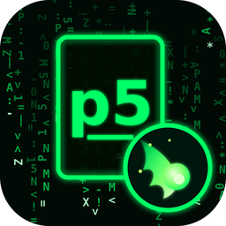

# p5assets

[Deutsch](README.de.md) · **English**

**Find and replace missing posters and season posters for Plex, Sonarr, Radarr and Kometa.**

A small Docker container with a Matrix look. It compares your libraries with your
[Kometa](https://kometa.wiki) assets folder, shows what is missing and saves new images with Kometa-compatible names.


-ffcc00?labelColor=0a1a0f)

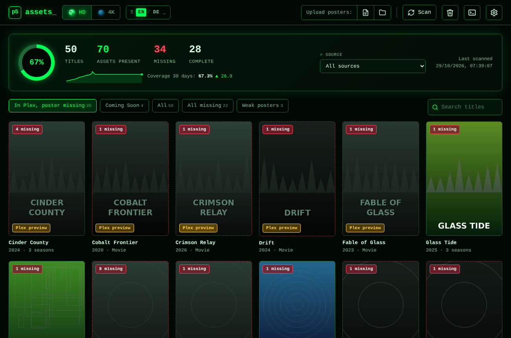

<sub>All titles in the screenshots are made up.</sub>

</div>

## Features

The interface is available in English and German. English is the default; use the `$ EN/DE` switch in the header to change it.

### Find what is missing
p5assets matches Plex, Sonarr and Radarr titles by their TMDb, TVDB and IMDb IDs. The tabs show what needs work:

- “In Plex, poster missing” (the start view): titles that show up in Plex without an image
- “Coming Soon”
- “All”
- “All missing”: also includes titles that only Sonarr/Radarr know about, marked “Not in Plex yet”
- “Weak posters”

You also get a source filter, a search next to the tabs (it always searches all titles in the current world), an A–Z bar and a coverage indicator with a small history graph (one point per scan).
Large libraries are no problem: with more than 6000 titles, the lists respond in about 30 ms.

### Replace by drag & drop
Drop an image onto a tile, or drop several files, whole folders or ZIPs anywhere in the window. You can also use “Upload posters:” in the header (file/ZIP icon or folder icon; on iPhone and iPad there is a single button, and folders have to be zipped first).
p5assets reads the title, year and season from file and folder names, shows you the matches to confirm, and renames everything the way Kometa expects (`<media folder>/poster.jpg`, `Season01.jpg` …). New folders are created next to your existing titles.

**Set check on import:** When an upload contains a series set (or several series in one ZIP, grouped by series), p5assets checks for each series how many seasons Plex and Sonarr know, whether the set covers all of them, whether the series poster and specials are included, and which existing images would be replaced.

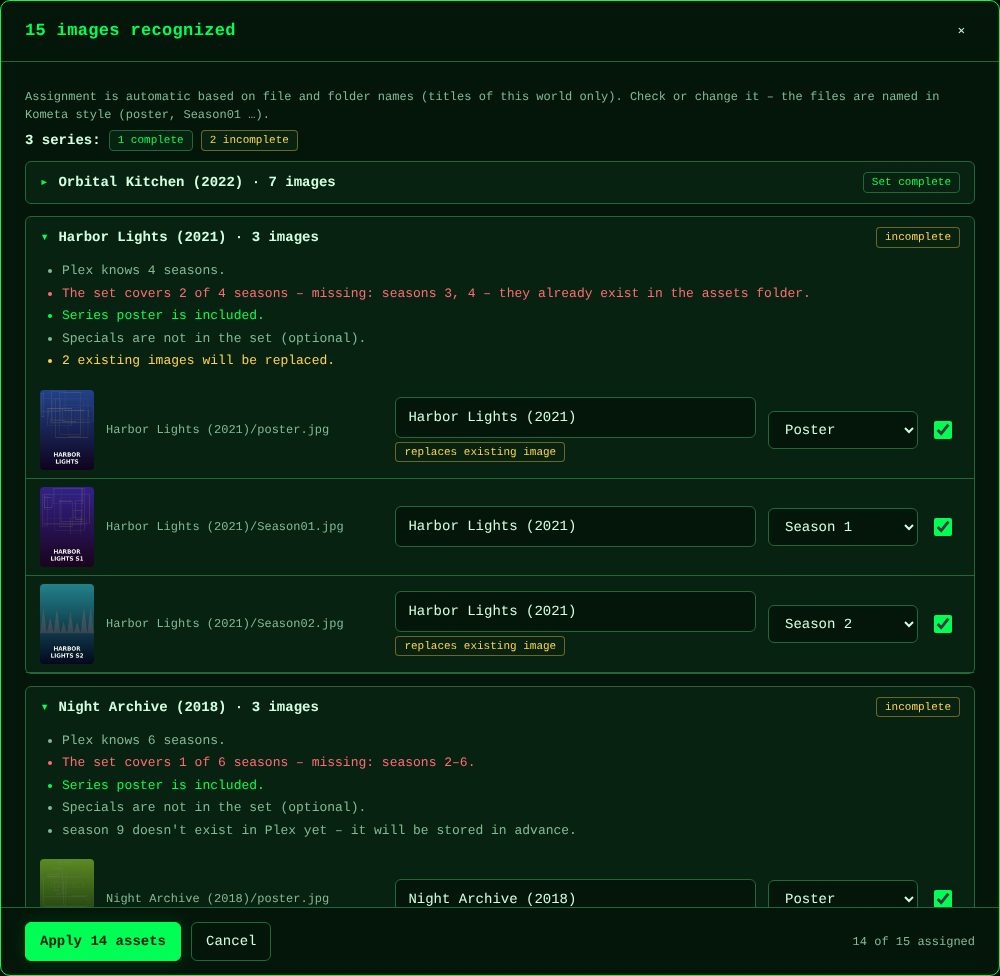

<table>
<tr>
<td width="50%">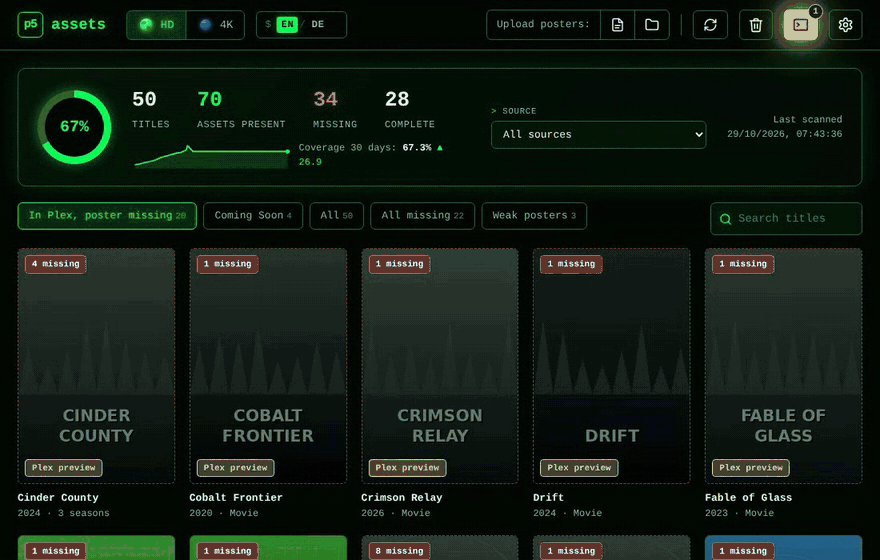<br><sub>Adding season posters: the Matrix rain only runs where something changes</sub></td>
<td width="50%">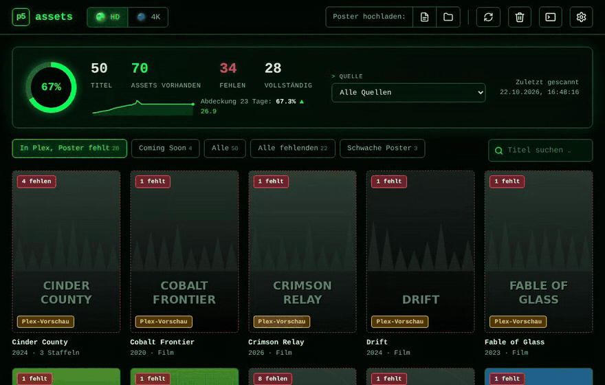<br><sub>Uploading a ZIP: automatic matching, and coverage goes up</sub></td>
</tr>
</table>

### Movies and series
<table>
<tr>
<td width="50%">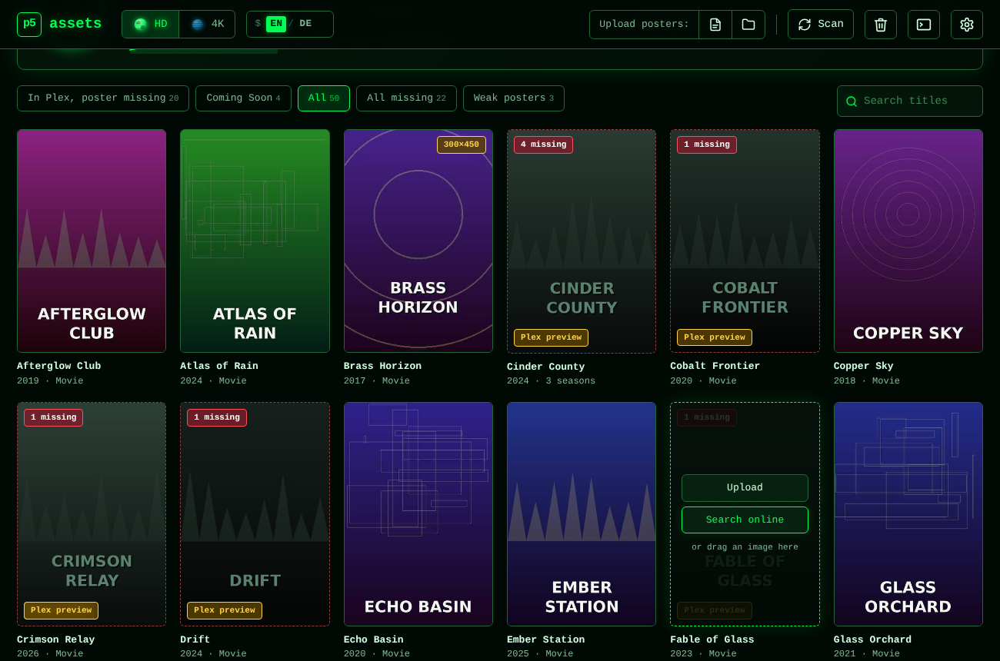<br><sub>Edit movies directly on the poster (tap it on a touchscreen)</sub></td>
<td width="50%">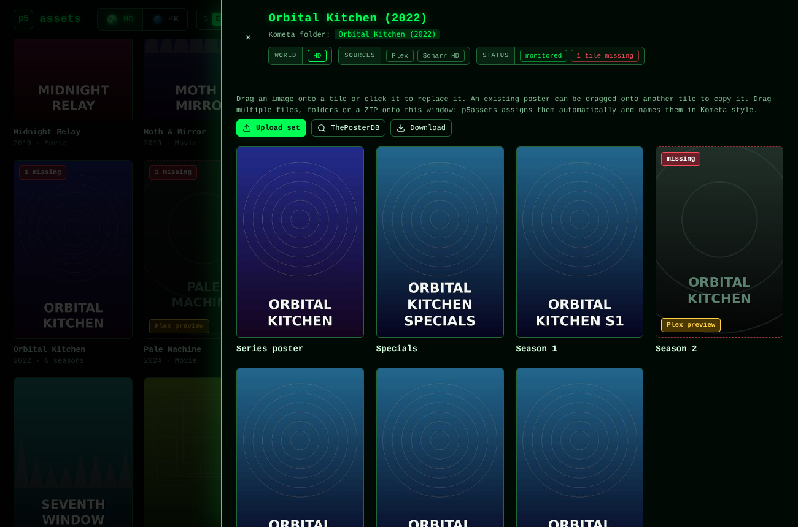<br><sub>Series: poster and seasons, “Upload set”, ThePosterDB link, ZIP download</sub></td>
</tr>
</table>

- Tiles for the poster and **Season00 to Season50**, including seasons that do not exist yet.
- **Copy** a poster to another tile by dragging it there, or to several tiles at once with “Apply to all …”.
- **Plex collections:** The movie preview lists the movie's collections. One click opens the collection's detail view with all its posters (replace, upload, upload a set). On import, movies are grouped by Plex collection, and p5assets tells you which movies in the collection will still have no poster. Files named “… Collection” are never matched to a movie automatically. Large catch-all collections that are not movie series can be hidden; “Settings → Libraries” lists them and lets you show them again.

<table>
<tr>
<td width="50%">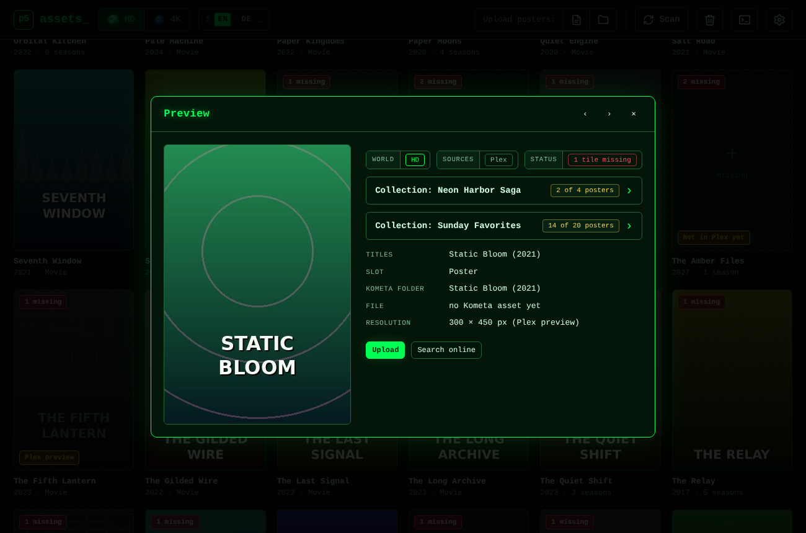<br><sub>The preview lists the movie's Plex collections</sub></td>
<td width="50%">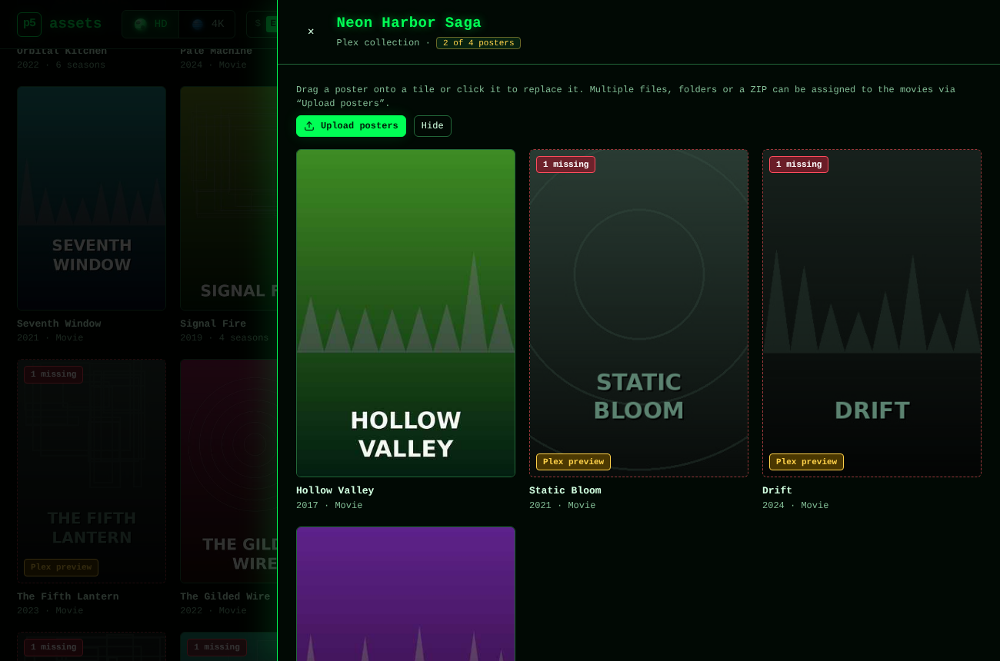<br><sub>Detail view with every poster in the collection; missing ones can be replaced right there</sub></td>
</tr>
</table>

- **Download** in original quality: single posters, or a selection as a ZIP. On iPhone/iPad the original opens in p5assets; long-press the image and choose “Add to Photos”.

### Online search
Posters from TMDb, TVDB and fanart.tv, sorted by your **preferred poster languages per world** (e.g. Textless → German → English), applied with one click.
For ThePosterDB, a link opens the site's search with the matching title. Download the poster or set there and drop it into p5assets (no login and no scraping on p5assets' side).

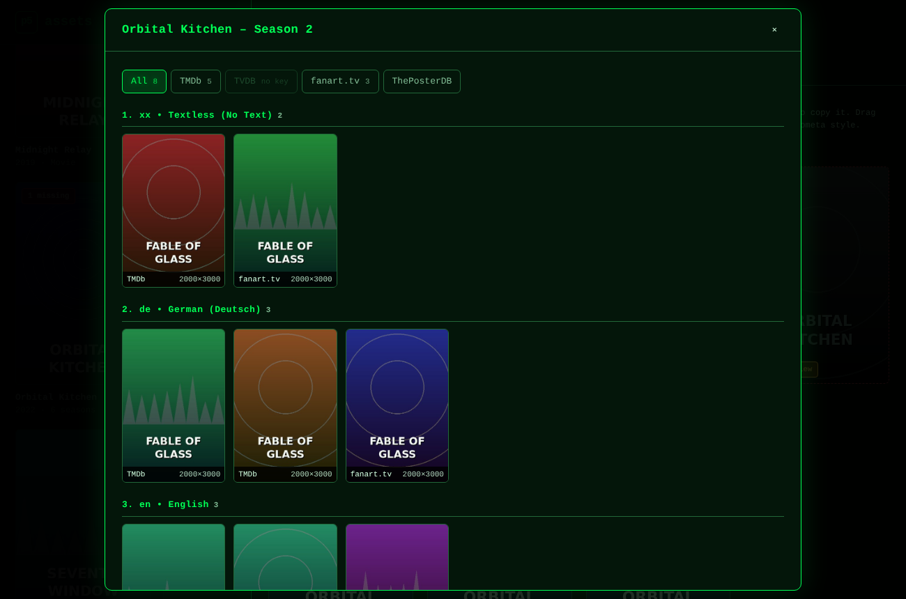

### Worlds (HD, 4K, …)
Each world is a separate area with its own assets folder, title list, dashboard and **color**. There are ten worlds to choose from, each with its own planet in the header, and switching between them is a short trip through a wormhole. You assign libraries and Sonarr/Radarr instances to worlds by drag & drop.

<table>
<tr>
<td width="50%">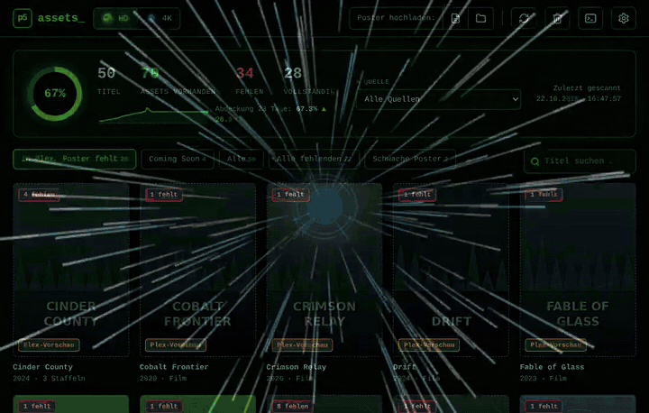<br><sub>Switching worlds: HD ↔ 4K</sub></td>
<td width="50%">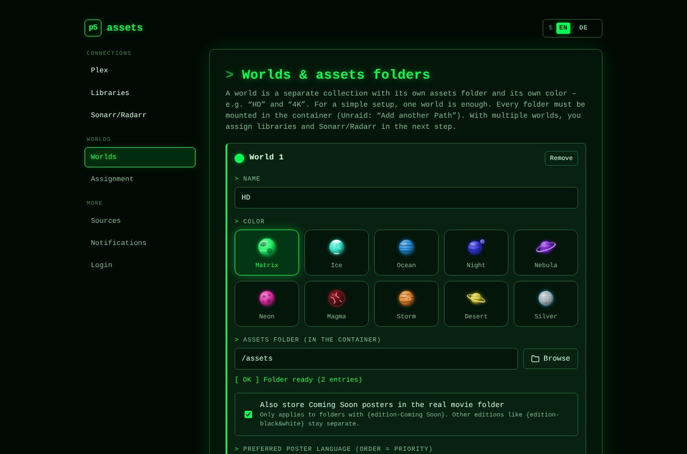<br><sub>Ten worlds, each with its own planet</sub></td>
</tr>
</table>

### Coming Soon
Plex placeholders with `{edition-Coming Soon}` in the folder name get their own tab (optionally only those without a poster).
Their posters are also saved in the real Radarr/Sonarr folder (you can turn this off per world), so they are still there once the real file arrives. Other editions are not affected.

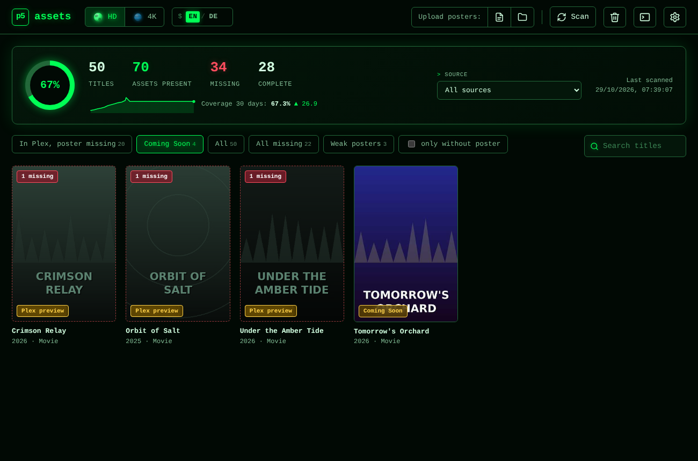

### Weak posters
This tab finds images that are too small or not 2:3. You set the thresholds (minimum width, aspect ratio) yourself; image sizes are read in the background.

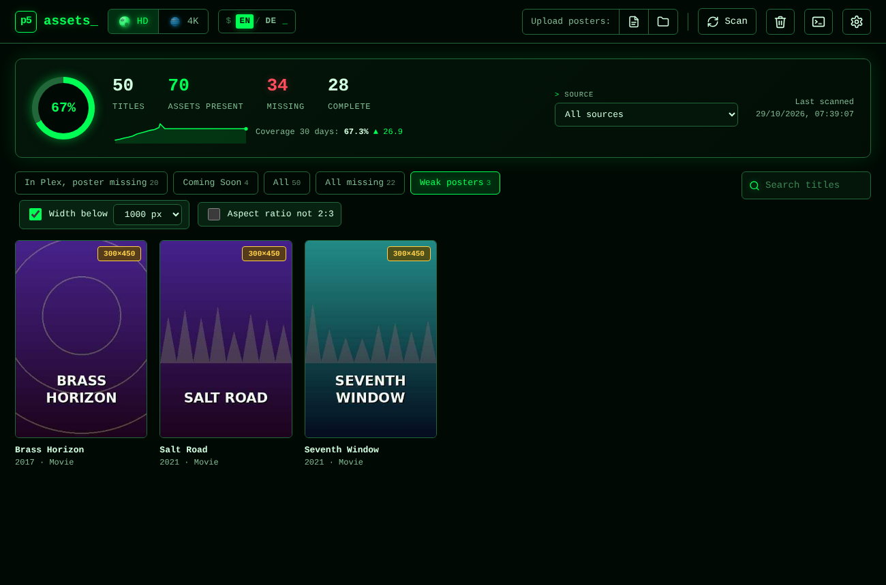

### Trash and cleanup
Replaced or deleted posters stay in the trash for **30 days** (2 GB max.). After every change, a notice offers “Undo”, and the trash icon in the header opens the full list.
**Orphaned folders** (posters for titles that are no longer in Plex or Sonarr/Radarr) can be found and moved to the trash. Titles that Sonarr/Radarr still know are never touched.

<table>
<tr>
<td width="50%">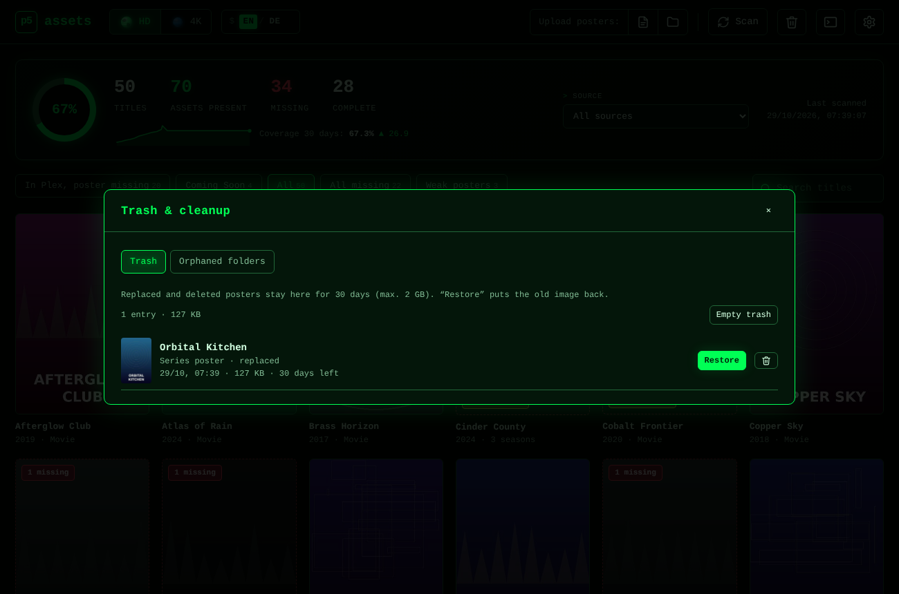<br><sub>Trash with restore</sub></td>
<td width="50%">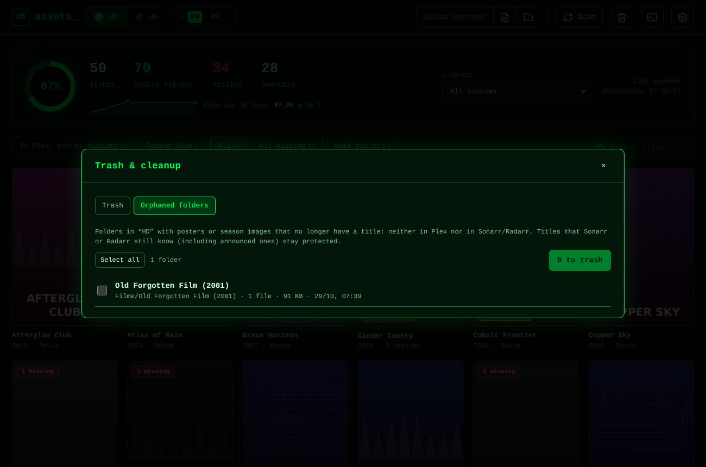<br><sub>Cleaning up orphaned folders</sub></td>
</tr>
</table>

### Notifications
After a scan, p5assets can notify you via **Discord, Telegram or ntfy**, but only about two things:
new titles in “In Plex, poster missing” (one message, with Coming Soon titles marked, e.g. “4 new titles without poster, 2 of them Coming Soon”) and scan errors (once per error). The messages themselves are always in English.
The first scan only records the starting point. Set this up during onboarding (optional) or later in the settings, where you can also send a test message.

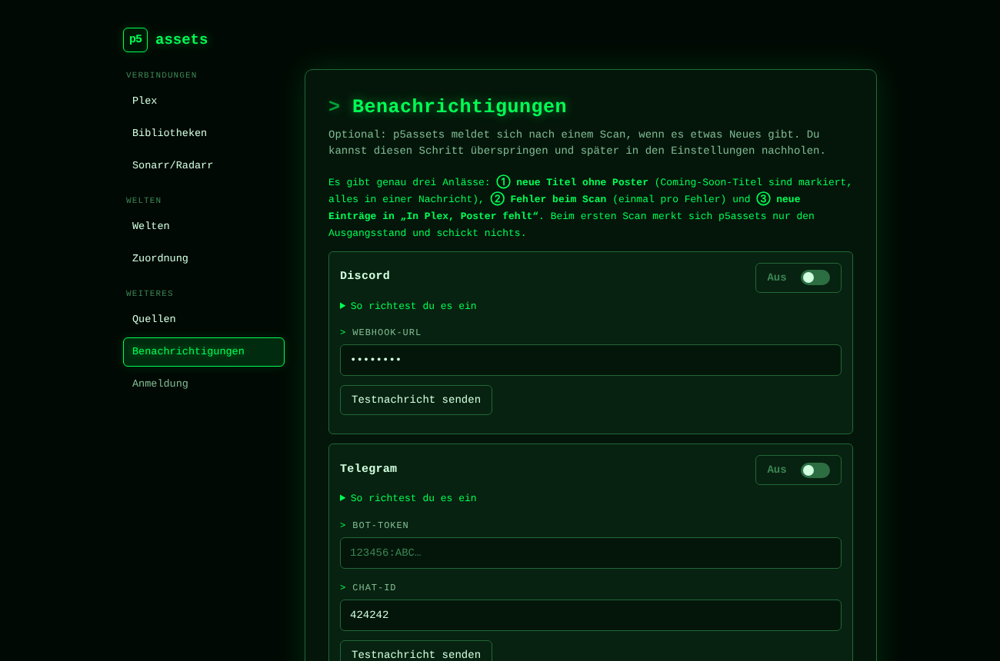

### Logs, updates, mobile
- **Logs** (`>_` icon): live log with search, level filter and download. When there are new warnings or errors, the icon lights up and shows how many. Tokens and API keys are never logged.
- **Updates:** After an update, a short “New in version …” notice lists the highlights. The full list, grouped by version, is under “What's new” in the footer, with buttons to set up new features right away.
- **Home screen app** on iPhone/iPad (Share → Add to Home Screen) with a compact top bar and large tap targets. On mobile the settings are a grouped list; on desktop they have a sidebar.
- **Keyboard shortcuts:** `/` jumps to the search field, `Esc` clears it, and `←`/`→` page through movies in the poster preview. Clicking the logo always takes you back to the start view.

<table>
<tr>
<td width="50%">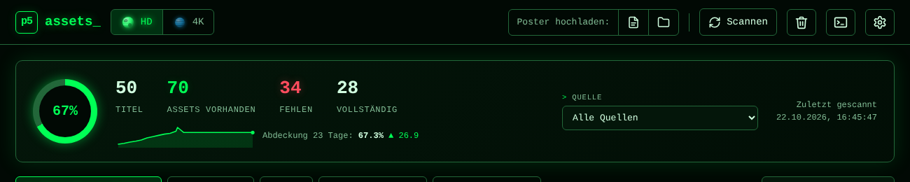<br><sub>Log icon with alert, plus a notice on the dashboard</sub></td>
<td width="50%">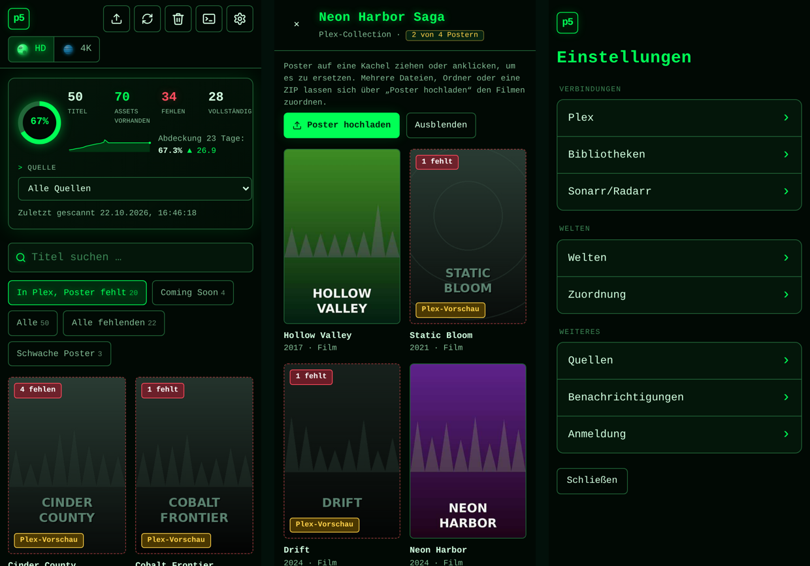<br><sub>Mobile view on iPhone</sub></td>
</tr>
</table>

## Quick start (Docker Compose)
```yaml
services:
  p5assets:
    image: ghcr.io/p5lukas/p5assets:dev
    ports: ["8484:8080"]
    environment: { PUID: 99, PGID: 100, UMASK: "002", TZ: Europe/Berlin }
    volumes:
      - ./config:/config
      - /path/to/kometa/assets:/assets          # world 1 (e.g. HD), must be your Kometa asset_directory
      - /path/to/kometa/assets-4k:/assets-4k    # optional: world 2 (e.g. 4K)
    restart: unless-stopped
```
Then open http://localhost:8484 and go through onboarding (Plex, worlds, Sonarr/Radarr, API keys). In the worlds step, enter the container path of each world's assets folder (`/assets`, `/assets-4k`).

The assets folders must be mounted **writable**. Folder names are taken from the media path in Plex or Sonarr/Radarr, because that is where Kometa looks for assets.

To build from source instead: `docker compose up -d --build` (with `build: .` in the compose file).

## Unraid
1. Copy the template to your server, for example from the Unraid terminal:
   `wget -O /boot/config/plugins/dockerMan/templates-user/my-p5assets.xml https://raw.githubusercontent.com/p5lukas/p5assets/dev/unraid/p5assets.xml`
   (or copy `unraid/p5assets.xml` over the network share to `\\<Unraid-IP>\flash\config\plugins\dockerMan\templates-user\my-p5assets.xml`).
2. Go to *Docker → Add Container* and pick **p5assets** under *User templates*.
3. Set the paths: **Config** (e.g. `/mnt/user/appdata/p5assets`), **Assets 1** (your Kometa `asset_directory`) and, if needed, **Assets 2** (e.g. 4K). **Assets 3** is under the advanced settings. Leave unused assets paths empty.
4. The host port defaults to **8484**. If it is taken, change only the host port, not the container port 8080.
5. Open the WebUI and go through onboarding. Use `http://<Unraid-IP>:32400` as the Plex URL, and `/assets`, `/assets-4k` or `/assets-3` as the worlds' assets folders.

Files are written as `PUID=99` / `PGID=100` (nobody/users). To update, use *Force Update* on the container.

### Image tags
| Tag | Source | Purpose |
|---|---|---|
| `:dev` | branch `dev` | newest features, for testing |
| `:latest` | branch `main` | stable |
| `:0.7.0` | Git tag `v0.7.0` | pinned version (e.g. `0.7.0`; `1.0.0` once the project is mature) |
| `:sha-…` | every build | troubleshooting |

While p5assets is in development, the template and compose file use `:dev`. Once it is stable, they will switch to `:latest` (branch `main`). To switch yourself, set the *Repository* field in the container settings to `ghcr.io/p5lukas/p5assets:latest`.

> If the GHCR package is private, Unraid needs to log in: `docker login ghcr.io -u p5lukas` with a token that has **only** the `read:packages` scope.

Images are built by a GitHub Action (`.github/workflows/docker.yml`) on every push to `dev` or `main` and on version tags. The tests (`pytest`) run before every build.

## Storage in `/config`
| Path | Contents | Size |
|---|---|---|
| `config.json` | settings and credentials (token, API keys; never logged) | small |
| `auth.json` | login (username and password hash) | small |
| `cache/thumbs-v3` | thumbnails for fast lists | up to 600 MB, cleaned up automatically |
| `trash` | trash for undo | up to 2 GB, 30 days |
| `cache/dims.json`, `history.json`, `logs` | image sizes, coverage history, logs | small |

## Login and password reset
You can protect p5assets with a **username and password** (onboarding step “Login” or later in the settings).
The password is stored only as a scrypt hash in `/config/auth.json`. You can stay signed in for 30 days, and after several failed attempts there is a waiting period. The login page uses the color of the world you used last.

<table>
<tr>
<td width="50%">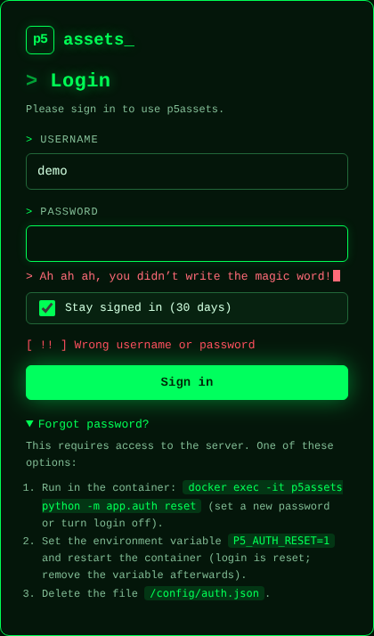<br><sub>Login page (after a wrong password, a small terminal joke appears; you can turn it off)</sub></td>
<td width="50%">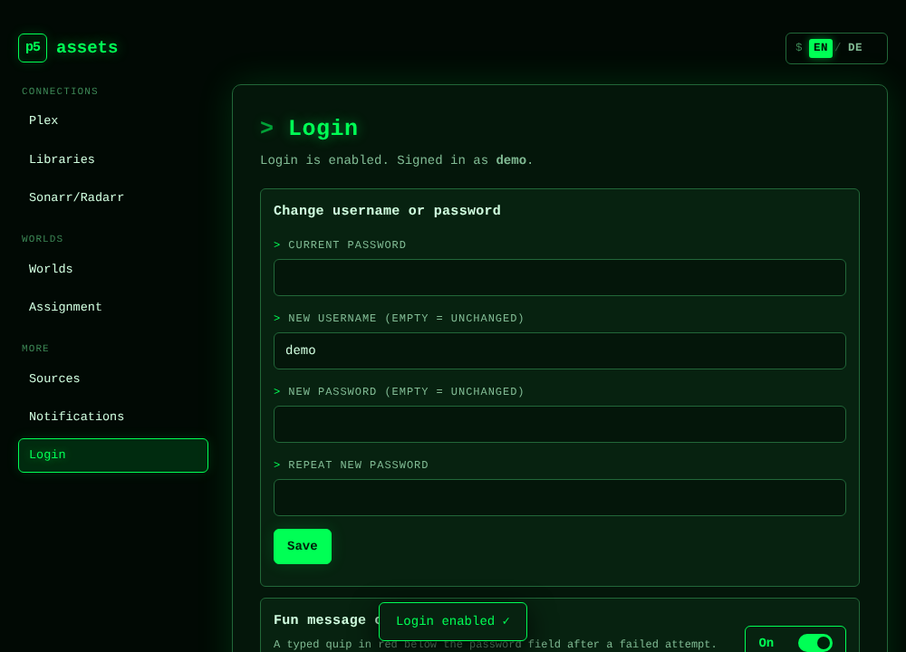<br><sub>Settings → Login</sub></td>
</tr>
</table>

**Forgot your password?** If you have access to the server, there are three ways:
1. `docker exec -it p5assets python -m app.auth reset` sets a new password or turns login off (`python -m app.auth status` shows the current state).
2. Set the environment variable `P5_AUTH_RESET=1` and restart the container. This turns login off; remove the variable afterwards and set up login again.
3. Delete `/config/auth.json`.

## Security
- Without login, anyone on your network can use p5assets. Do not expose it directly to the internet (no port forwarding). Use a VPN (e.g. WireGuard or Tailscale) or a reverse proxy with `https://`, so passwords and sessions are encrypted.
- The Plex token, API keys and notification credentials are stored in `/config/config.json` and are never written to the log.
- Connections to Plex, Sonarr and Radarr accept self-signed certificates (common with `https://` on a LAN). Online search and notifications use normal certificate verification.

## License
p5assets is licensed under the [GNU General Public License v3.0](LICENSE) (GPL-3.0): you may use, modify and share the code.
If you distribute modified versions, they must also be licensed under the GPL-3.0 and come with their source code.
p5assets is an independent project and is not affiliated with Plex, Sonarr, Radarr, Kometa, TMDb, TVDB, fanart.tv or ThePosterDB.
