<div align="center">

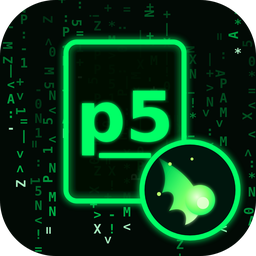

# p5assets

[Deutsch](README.de.md) · **English**

**Missing posters and season covers for Plex, Sonarr, Radarr and Kometa – find, replace, done.**

A lean Docker container with a Matrix look. It compares your libraries with the
[Kometa](https://kometa.wiki) assets folder, shows you what is missing, and saves new images automatically with Kometa-compatible names.


-ffcc00?labelColor=0a1a0f)

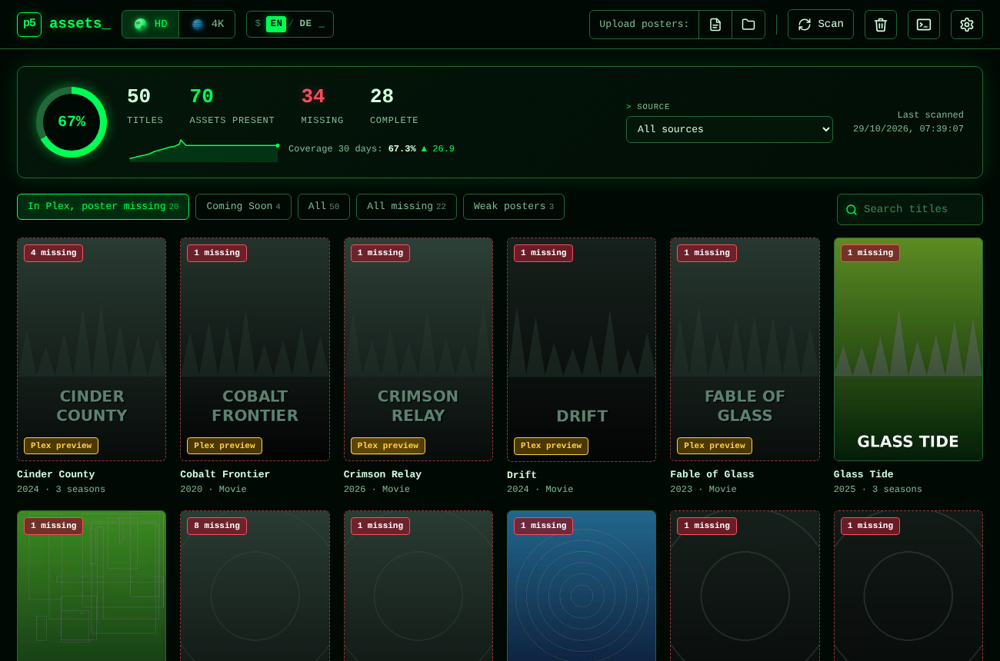

<sub>All titles in the images are made up.</sub>

</div>

## Features

The interface is available in English and German (language switch in the header, English is the default).

### Find gaps
Plex, Sonarr and Radarr are merged (via TMDb/TVDB/IMDb IDs). Tabs show right away what needs doing:
**In Plex, poster missing** (the start view: what shows up in Plex without an image), **Coming Soon**, **All**, **All missing** (including titles only Sonarr/Radarr know about and that are not in Plex yet, labeled "Not in Plex yet") and **Weak posters**.
There is also a source selector, a quick search (right of the tabs, always searches all titles of the world), an A–Z bar and a coverage indicator with a small history per scan.
Large libraries are no problem: with over 6000 titles the lists respond in about 30 ms.

### Replace by drag & drop
Drag an image onto a tile, or several files, whole folders or ZIPs anywhere into the window – or pick them via "Upload posters:" in the header (file/ZIP icon or folder icon; on iPhone and iPad there is a single button, and folders go in as a ZIP). p5assets recognizes title,
year and season from file and folder names, shows the matching for you to check, and renames everything the Kometa way
(`<media folder>/poster.jpg`, `Season01.jpg` …). New folders end up where your other titles already are.

**Set check on import:** If an upload contains a series set (even several series in one ZIP, grouped by series), p5assets checks
for each series how many seasons Plex (and Sonarr) know, whether the set covers all of them, whether the series poster and the specials are included,
and which existing images would be replaced.

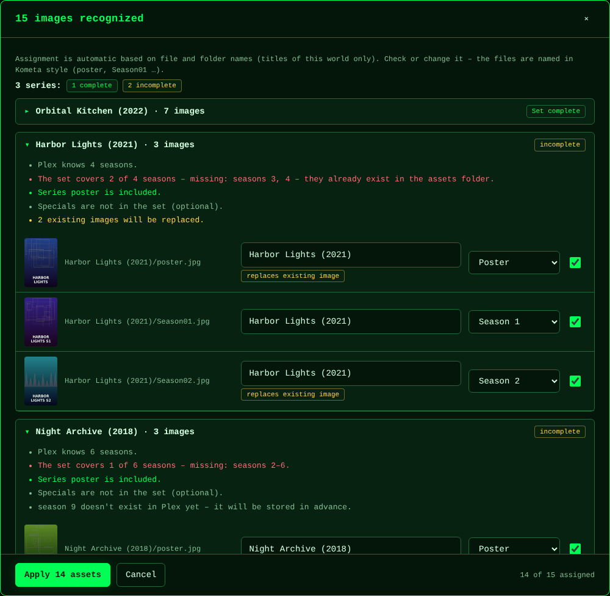

<table>
<tr>
<td width="50%">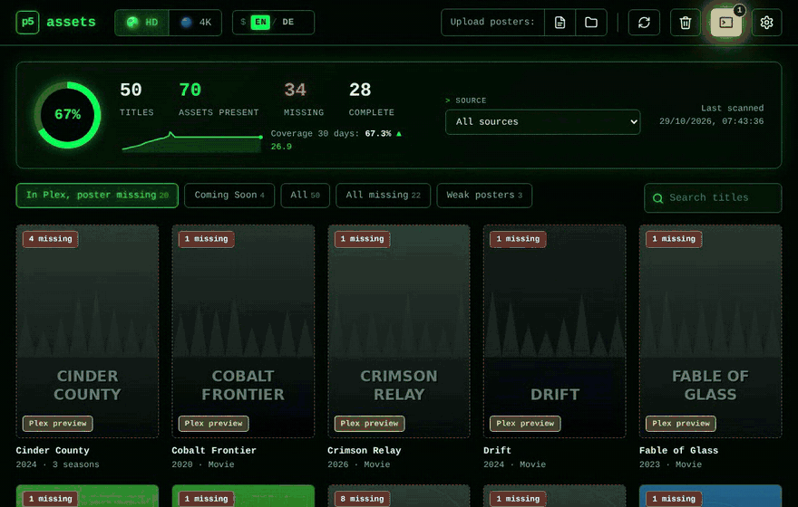<br><sub>Adding season posters – Matrix rain only where something changes</sub></td>
<td width="50%">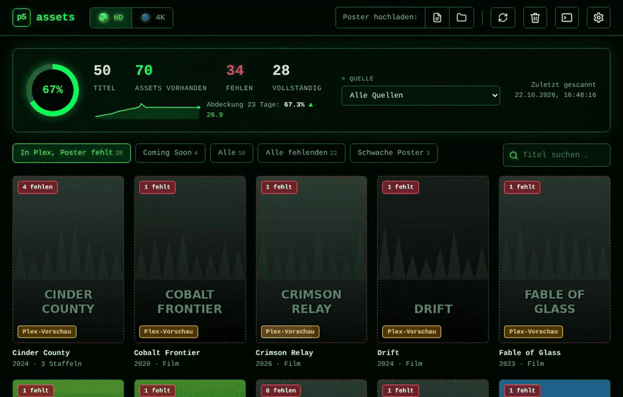<br><sub>Upload a ZIP: automatic matching, coverage goes up</sub></td>
</tr>
</table>

### Movies and series
<table>
<tr>
<td width="50%">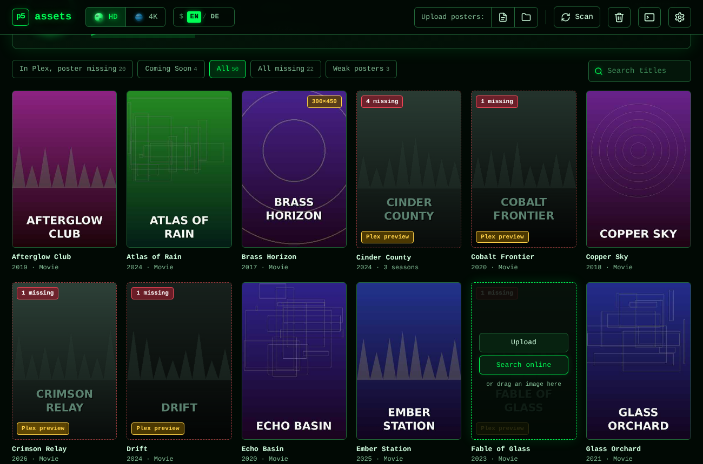<br><sub>Edit movies right on the poster (by tapping on a touchscreen)</sub></td>
<td width="50%">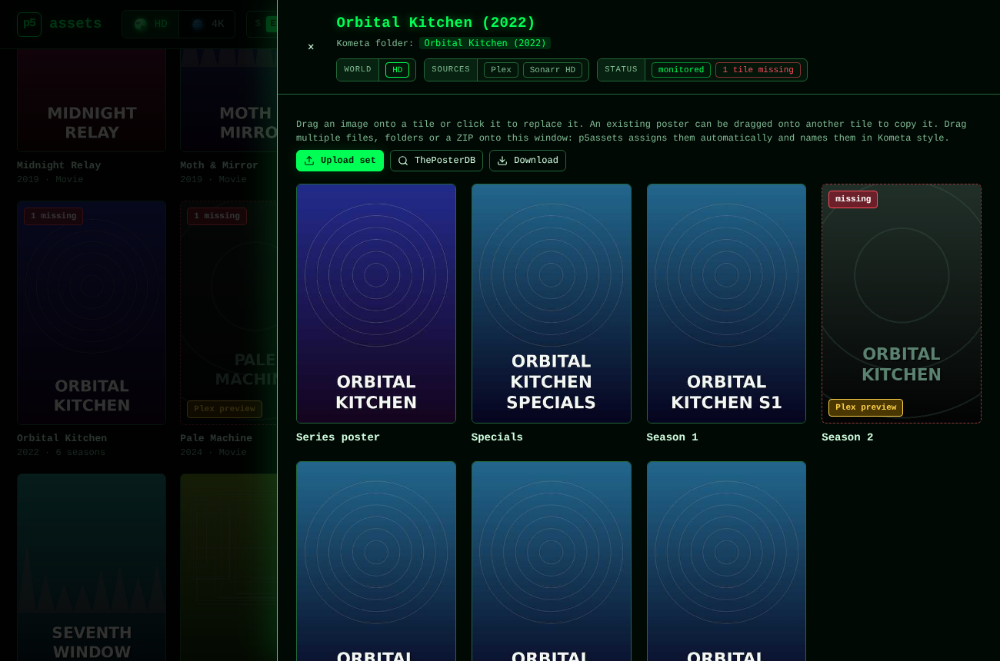<br><sub>Series: poster and seasons, <b>Upload set</b>, ThePosterDB link, ZIP download</sub></td>
</tr>
</table>

- Tiles for poster and **Season00 – Season50**, even for seasons that do not exist yet
- **Copy** a poster to another tile by drag & drop, or transfer it to several tiles with **"Apply to all …"**
- **Plex collections:** Movies show their collection in the preview; one click opens the collection's detail view with all posters (replace, upload, set upload). On import, movies are grouped by Plex collection and p5assets tells you which movies of the collection still have no poster afterwards. Files like "… Collection" are not matched to a movie automatically; large catch-all collections that are not movie series can be hidden (Settings → Libraries shows them and brings them back)

<table>
<tr>
<td width="50%">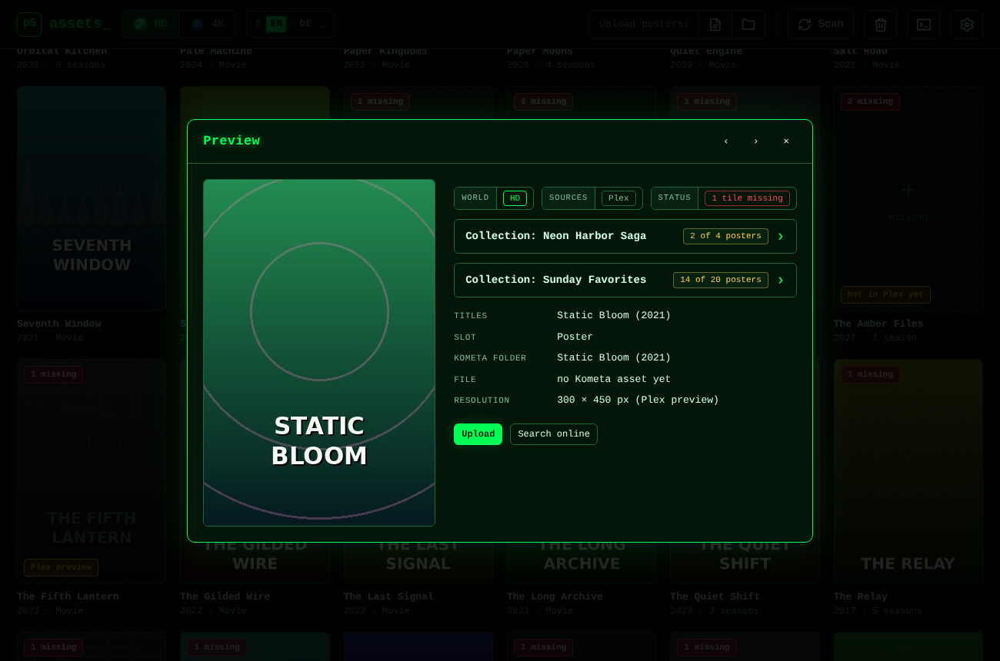<br><sub>The preview lists the movie's Plex collections</sub></td>
<td width="50%">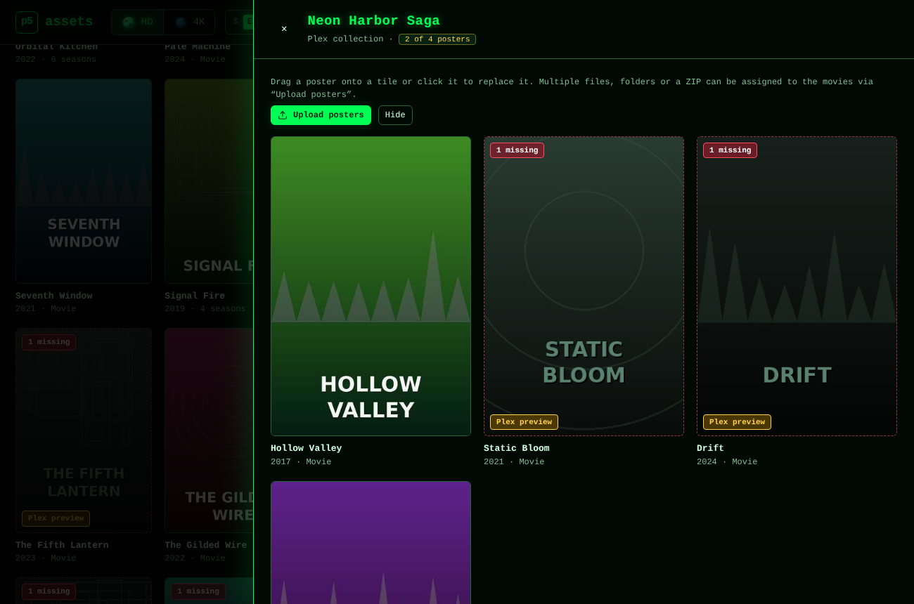<br><sub>Detail view: all posters of the collection, missing ones can be replaced right away</sub></td>
</tr>
</table>

- **Download** in original quality: single posters or a selection as a ZIP (on iPhone/iPad the original opens in p5assets: long-press the image → "Add to Photos")

### Online search
Posters from TMDb, TVDB and fanart.tv, grouped by your **language priority per world** (e.g. Textless → German → English),
applied with one click. For ThePosterDB, a link opens the search with the matching name; you simply drop the poster
or set you download there into p5assets (no login, no scraping of the site).

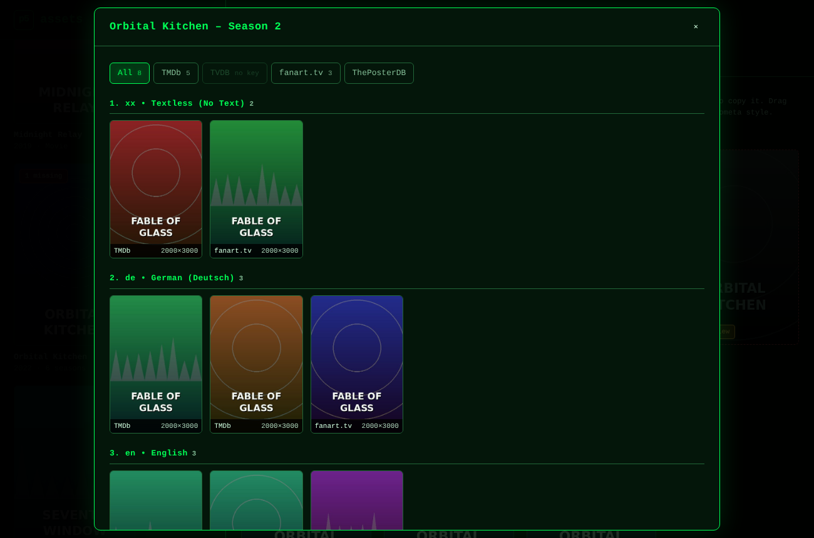

### Worlds (HD, 4K, …)
Separate areas, each with its own assets folder, its own title list, its own dashboard and **its own color**: ten worlds
to choose from, each with its own planet in the header; switching is a short wormhole trip. You assign libraries and
Sonarr/Radarr instances to worlds by drag & drop.

<table>
<tr>
<td width="50%">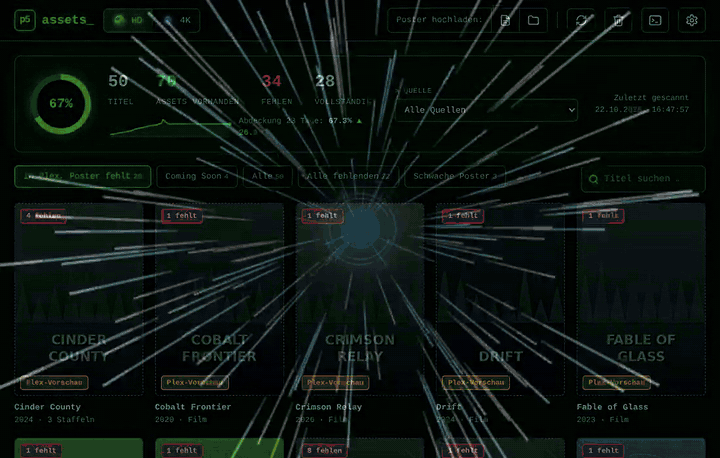<br><sub>Switching worlds HD ↔ 4K</sub></td>
<td width="50%">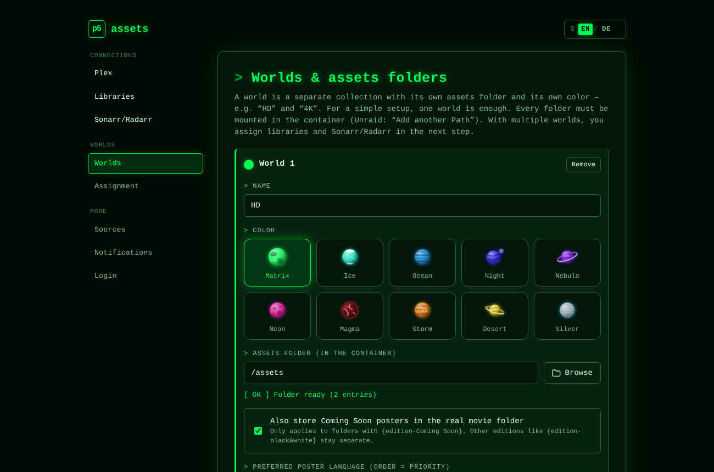<br><sub>Ten worlds, each with its own planet</sub></td>
</tr>
</table>

### Coming Soon
Plex placeholders with `{edition-Coming Soon}` in the folder name get their own tab (optionally only those without a poster).
Their posters are also saved in the real Radarr/Sonarr folder (can be turned off per world), so they survive the switch
to the real file. Other editions stay separate.

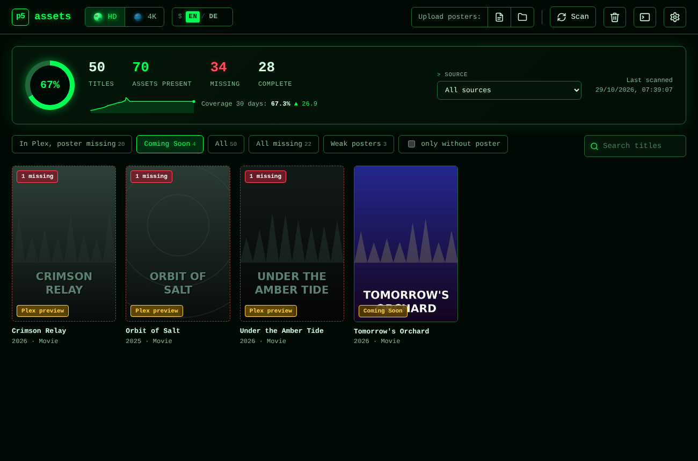

### Quality check: Weak posters
The tab finds images that are too small or not 2:3. You choose the thresholds (minimum width, aspect ratio) yourself;
image sizes are read in the background.

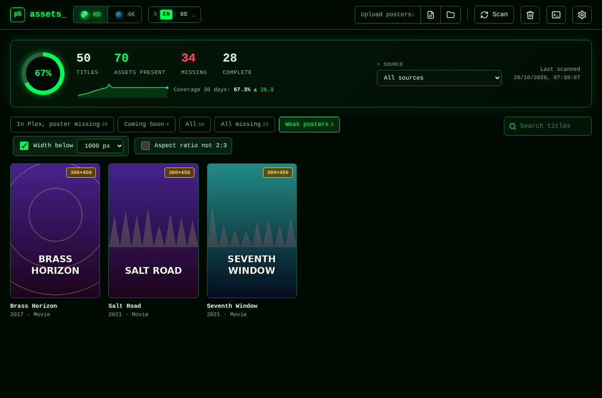

### Trash & cleanup
Replaced or deleted posters stay in the trash for **30 days** (at most 2 GB). After every action, a notice offers
"Undo"; the trash icon in the header opens the full list. **Orphaned folders** (posters without a title in Plex,
Sonarr/Radarr) can be found and moved to the trash; titles that Sonarr/Radarr
still know stay protected.

<table>
<tr>
<td width="50%">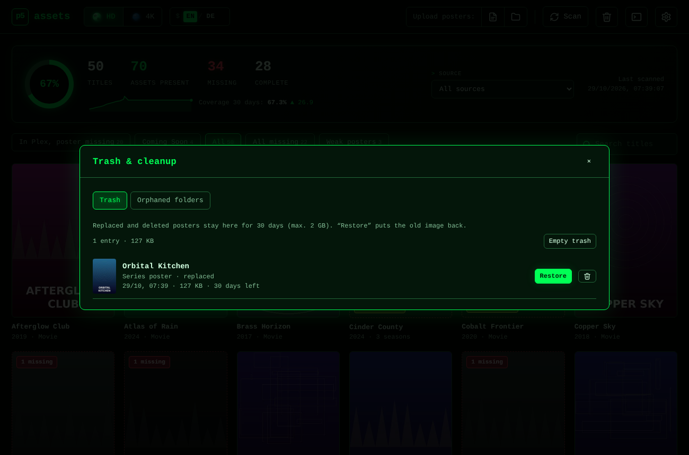<br><sub>Trash with restore</sub></td>
<td width="50%">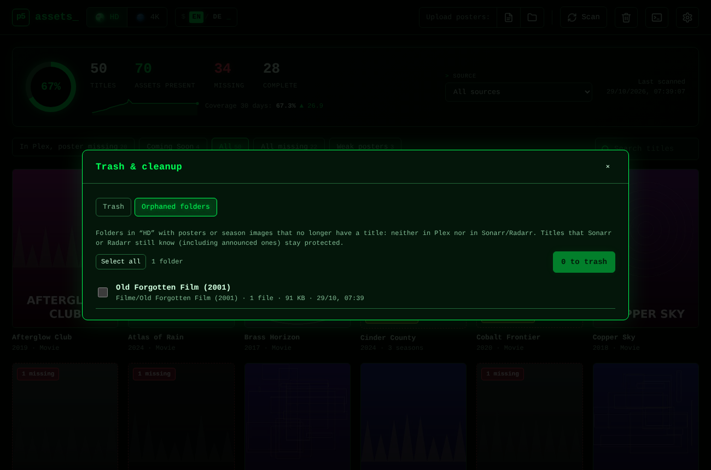<br><sub>Cleaning up orphaned folders</sub></td>
</tr>
</table>

### Notifications
After a scan, p5assets reports via **Discord, Telegram or ntfy** – and only for three occasions:
new titles without a poster (Coming Soon titles are counted too: "4 new titles without a poster, 2 of them Coming Soon"),
scan errors (once per error) and new entries under "In Plex, poster missing". The first scan only sets the
baseline. Set it up in onboarding (skippable) or later in Settings, with a test message.

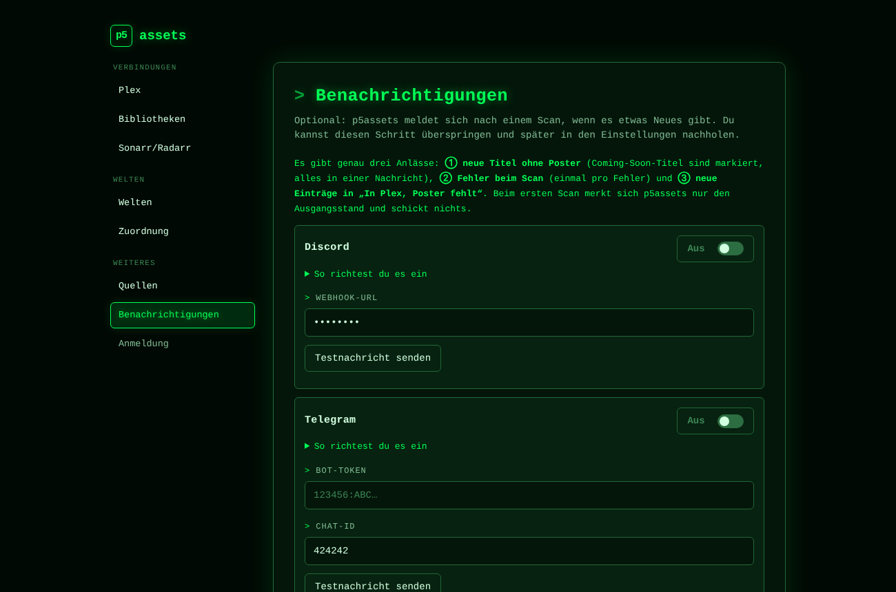

### Logs, What's new, mobile
- **Log page** (`>_` icon): live log with search, level filter and download. On new warnings or errors the icon lights up and shows the count. Tokens and API keys are never logged.
- **New in this update**: after an update, p5assets shows what is new and offers new features for setup right away (later any time via "What's new" in the footer).
- **As an app** on iPhone/iPad (Share → Add to Home Screen), with a compact top bar and large tap targets; Settings there are a grouped list (a sidebar on desktop).
- **Keyboard shortcuts:** `/` jumps to the search field, `Esc` clears it, in the poster preview `←`/`→` page through the movies. Clicking the logo always takes you to the start page.

<table>
<tr>
<td width="50%">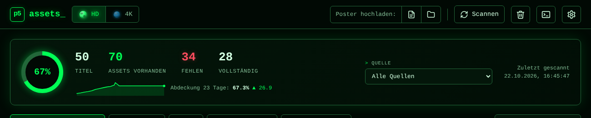<br><sub>Log icon with alert and notice on the dashboard</sub></td>
<td width="50%">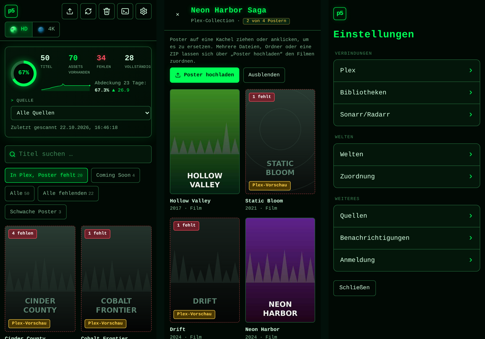<br><sub>Mobile / iPhone</sub></td>
</tr>
</table>

## Quick start (Docker Compose)
```yaml
services:
  p5assets:
    image: ghcr.io/p5lukas/p5assets:dev
    ports: ["8484:8080"]
    environment: { PUID: 99, PGID: 100, UMASK: "002", TZ: Europe/Berlin }
    volumes:
      - ./config:/config
      - /pfad/zu/kometa/assets:/assets          # Welt 1 (z. B. HD) – muss dein Kometa asset_directory sein
      - /pfad/zu/kometa/assets-4k:/assets-4k    # optional: Welt 2 (4K)
    restart: unless-stopped
```
Then open http://localhost:8484 and go through onboarding (Plex, worlds, Sonarr/Radarr, API keys).
The assets folders must be mounted **writable**. Folder names are derived from the media path in Plex or
Sonarr/Radarr – that is how Kometa looks for assets.

From source: `docker compose up -d --build`.

## Unraid
1. Get the template **and icon** onto the server. The easiest way is a network share (also works with a private repo):
   `unraid/p5assets.xml` → `\\<Unraid-IP>\flash\config\plugins\dockerMan\templates-user\my-p5assets.xml`
   (Alternatively, with a public repo, via terminal:
   `wget -O /boot/config/plugins/dockerMan/templates-user/my-p5assets.xml https://raw.githubusercontent.com/p5lukas/p5assets/dev/unraid/p5assets.xml`)
2. *Docker → Add Container* → choose the template **p5assets** under *User templates*.
3. Set the paths: **Config** (e.g. `/mnt/user/appdata/p5assets`), **Assets 1** (your Kometa `asset_directory`),
   and if needed **Assets 2** (e.g. 4K). Leave unused assets paths empty.
4. The host port is **8484** by default. If it is taken, change only the host port, not the container port 8080.
5. Open the WebUI and go through onboarding. As the Plex URL, enter `http://<Unraid-IP>:32400`.

### Image tags
| Tag | Source | Purpose |
|---|---|---|
| `:dev` | branch `dev` | try new things |
| `:latest` | branch `main` | stable |
| `:0.6.0` | Git tag `v0.6.0` | fixed version (currently `0.6.0`, `1.0.0` only once it is mature) |
| `:sha-…` | every build | troubleshooting |

While p5assets is in development, the template and compose file use `:dev`. Once everything runs stably,
they will switch to `:latest` (branch `main`): in the container form, change the *Repository* field to
`ghcr.io/p5lukas/p5assets:latest`.

> If the GHCR package is private, Unraid needs a login: `docker login ghcr.io -u p5lukas` with a token that may **only** have `read:packages`.

The build runs via GitHub Action (`.github/workflows/docker.yml`) on push to `dev` or `main`.
Files are written with `PUID=99` / `PGID=100` (nobody/users).
Updates: update the container in Unraid with *Force Update*.

## Storage needs in `/config`
| Folder | Contents | Size |
|---|---|---|
| `config.json` | settings, credentials (token/API keys, never in the log) | small |
| `cache/thumbs-v3` | thumbnails for fast lists | at most 600 MB, cleaned up automatically |
| `trash` | trash with undo | at most 2 GB, 30 days |
| `cache/dims.json`, `history.json`, `logs` | image sizes, coverage history, log | small |

## Login & resetting the password
p5assets can optionally be protected with a **username and password** (onboarding step "Login" or later in Settings).
The password is stored only as a hash (scrypt) in `/config/auth.json`, the login stays valid for 30 days if you wish, and after several
failed attempts there is a waiting period. The login page takes on the color of the world you used last.

<table>
<tr>
<td width="50%">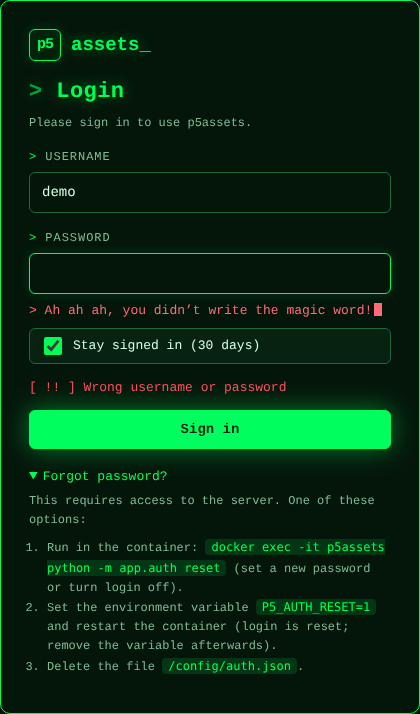<br><sub>Login page (after a wrong password: a small terminal surprise, can be turned off)</sub></td>
<td width="50%">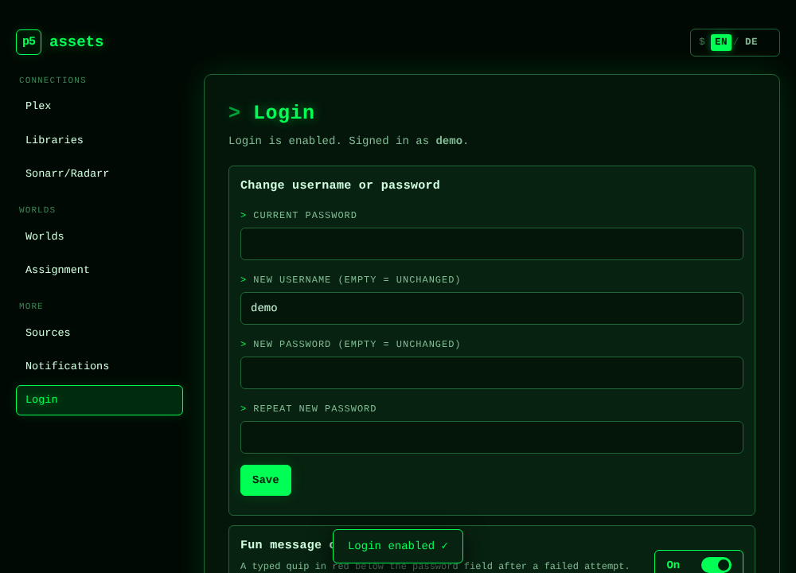<br><sub>Settings → Login</sub></td>
</tr>
</table>

**Forgot your password?** With access to the server there are three ways:
1. `docker exec -it p5assets python -m app.auth reset` – set a new password or turn login off (`python -m app.auth status` shows the current state).
2. Set the environment variable `P5_AUTH_RESET=1` and restart the container: login is reset (then remove the variable again and set it up anew).
3. Delete the file `/config/auth.json`.

## Notes
Without login enabled, anyone on the network can use p5assets – so run it only on your home network or behind a reverse proxy with login.
When accessing it over the internet, please also use `https://` (reverse proxy) so that password and session are transmitted encrypted.
Tip: p5assets does not belong directly on the open internet (no port forwarding on the router). It is better to make it reachable via VPN (e.g. WireGuard/Tailscale) or behind a reverse proxy with `https://`.
Plex token, API keys and notification credentials are stored in `/config/config.json` and are never written to the log.
Connections to Plex, Sonarr and Radarr on the home network accept self-signed certificates (common with `https://` on a LAN); online search and notifications over the internet use normal certificate verification.

The tests (`pytest`) run in the GitHub Action before every image build.

## License
p5assets is licensed under the [GNU General Public License v3.0](LICENSE) (GPL-3.0): you may use, modify and share the code.
Derivative works that you distribute must also be licensed under the GPL-3.0 and make their source code available.
The project is independent of Plex, Sonarr, Radarr, Kometa, TMDb, TVDB, fanart.tv and ThePosterDB and is not affiliated with them.
